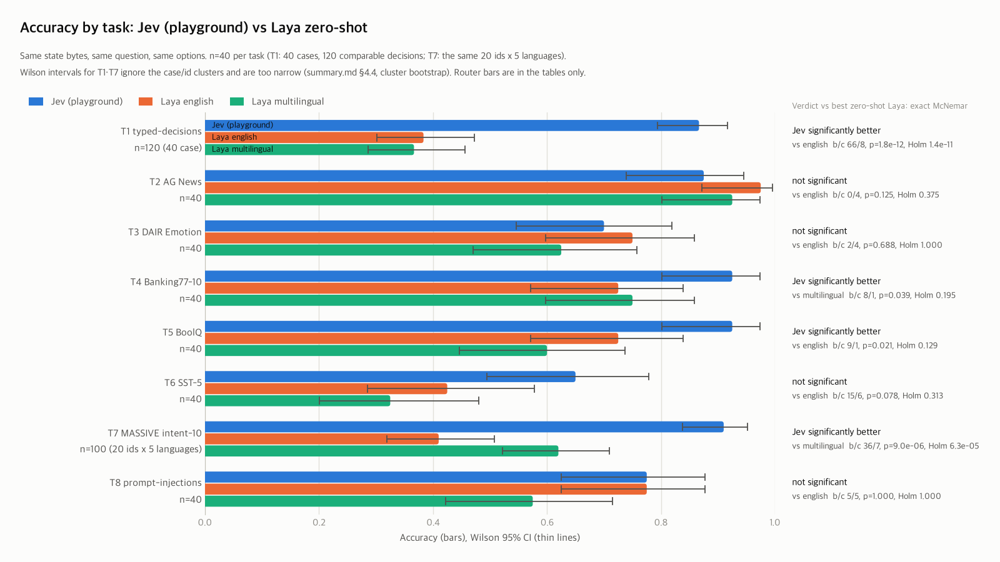
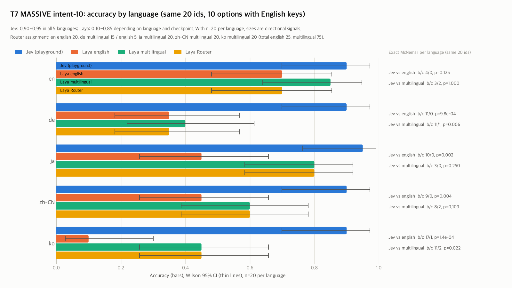
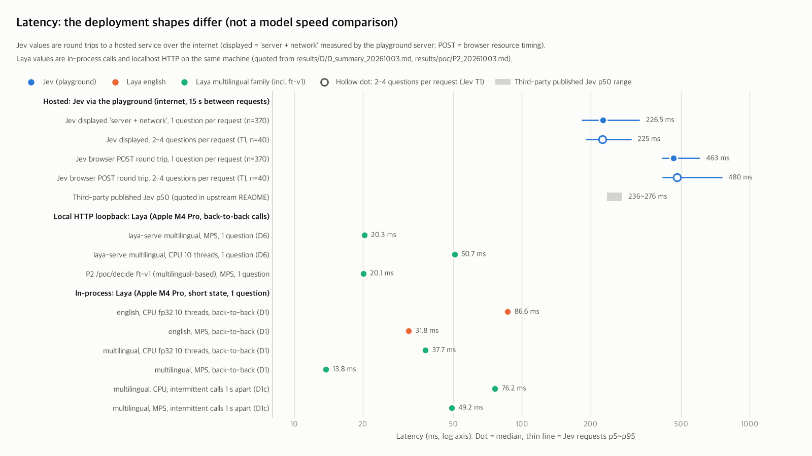

# Laya vs Jev controlled comparison synthesis (S6, 2026-10-07)

> This goes through an independent 3rd-party playground (jevplayground.com), not the API. The model version is not shown (Model ID `typesafe-ai/jev`). Each task is a small sample of n=40. All numbers in this document equal `results/F/jev_cmp/summary.json`, and `s6_summary.py verify` cross-checked them against the session summaries and the `jev_cmp.py` rerun output (§10).

**Verdict.**
1. Comparing Jev on each task with the zero-shot Laya runner that is most accurate on that task, using the exact McNemar test (two-sided, α 0.05), gives Jev significantly better on 4 (T1, T4, T5, T7), n.s. on 4 (T2, T3, T6, T8) and Laya significantly better on 0. With Holm correction over the 8 tests, Jev remains significantly better on only 2, T1·T7.
2. The 8-task macro accuracy is Jev 0.828, Laya english 0.646, multilingual 0.598, Router 0.661. In a paired bootstrap resampling the 8 tasks (10,000 resamples), Jev − Router is +0.167 [+0.044, +0.293] and Jev − per-task best Laya (post-hoc choice) is +0.153 [+0.031, +0.281]. These are descriptive statistics averaging 8 heterogeneous tasks.
3. Pooling the 240 mutually independent single questions (T2·T3·T4·T5·T6·T8, T6 by argmax) gives Jev 194 and per-task best Laya 176, b/c 39/21, exact McNemar p=0.0273. The clustered T1 (40 cases) and T7 (20 ids) are examined separately with a cluster bootstrap: Jev − best Laya is T1 +0.483 [+0.371, +0.597], T7 +0.290 [+0.100, +0.470].
4. The meaning of Jev's probabilities differs by question format. On single choice, 65% of the answers are shown as 100%, and 59% of the wrong answers have top ≥ 0.90. On Boolean, 0 answers are shown as 100%, and on T8 all 9 wrong answers are misses (FN). Multi-question (T1) is underconfident: the mean top of 0.733 is below the accuracy of 0.867. To let confidence decide what is handled automatically, thresholds must be fitted separately on per-task held-out data.
5. Laya's deficit comes from zero-shot format generalization and closes with fine-tuning. On T1 the typed-decisions fine-tuned checkpoint scores 104/120, equal to Jev (104/120) (b/c 10/10), and the Korean domain-routing ft-v1 scores 22/24 on the same 24 rows, at or above Jev (20/24). Both lines are reference lines, not zero-shot (§3).

## 1. Overview

| Item | Content | Source |
|---|---|---|
| Unit of comparison | The same state bytes (the JSON-serialized string `state_text` that Laya reads), the same question sentence, the same option strings in the same order. Requests whose body was byte-identical to the form payload: 411/411 | `docs/09_laya_vs_jev_plan.md` §4, `jev_runs_all.jsonl` `payload_exact` (not included in the public repository) |
| Jev | `POST /api/evaluate` of the public playground `https://jevplayground.com`. Model ID `typesafe-ai/jev` 410/410, probabilities·score rounded to the second decimal place 410/410 | session run cards, `jev_runs_all.jsonl` (not included in the public repository) |
| Laya | laya 0.3.23, revision `55cf4c4`, english / multilingual / Router (automatic choice per input), zero-shot, CPU fp32, intra-op 10 / inter-op 1, batch 8 (results/F/jev_cmp/run_laya.sh) | `results/F/jev_cmp/S0_20261006.md`, `laya_summary.md` |
| Tasks | T1\~T8, 8 tasks. n=40 per task; T1 is 120 comparable decisions from 40 cases, T7 is the same 20 ids x 5 languages = 100 | `data/evals/jev_cmp/MANIFEST.json` |
| Period (KST) | 2026-10-06: pilot 08:09\~08:33, S1 10:04\~10:17, S1b 10:29\~10:38. 2026-10-07: S2 08:49\~09:12, S3 13:36\~13:56, S4 14:16\~14:36, S5 14:53\~15:18 (first click\~last click) | session run cards |
| Requests | 438 to the site in total = master log 411 (S1 41, S1b 30, S2 80, S3 80, S4 80, S5 100) + 27 before the tooling (Korean pilot 25, status checks 2). By day: 2026-10-06 98, 2026-10-07 340 | `jev_runs_all.jsonl`, `results/F/jev_runs_raw.jsonl` (neither is included in the public repository), `S1_summary.md` §7 |
| Gaps | Minimum gap between Run clicks: S1 17.0 s, S1b 17.3 s, S2 12.1 s, S3 15.0 s, S4 15.0 s, S5 15.0 s (median 15.1\~17.5 s), pilot 21.6 s. Rule ≥ 10 s | request records `gap_from_prev_click_s` (not included in the public repository) |
| Errors | HTTP 502 2 times: pilot run 2 (session stopped per the rule, resumed 13 minutes later, and the same row succeeded), S2 run 1 (`UNAVAILABLE`, 1 retry of the same payload 73.7 s later succeeded). HTTP 429 0 times, rate-limit messages·captcha 0 times | `F_jev_20261006.md`, `S2_run_card.md` |
| Successful requests | master 410 + pilot 24. The analysis below covers the 410 master requests (490 decisions) and the 24 pilot rows | same sources |

## 2. Results by task

### 2.1 Summary table

| Task | n | Format / options | Laya training mix | Jev | Laya english | Laya multilingual | Laya Router | Jev vs best Laya: b/c, p (Holm p) | Brier Jev / best Laya | ECE Jev / best Laya | Verdict (after Holm) |
|---|---|---|---|---|---|---|---|---|---|---|---|
| T1 typed-decisions | 120 (40 cases) | mixed (Multiple questions: choice 50 / Boolean 60 / 5-level score 10) / 2\~4 questions per case, options ≤ 5 | no | 104/120 = 0.867 [0.794, 0.916] | 46/120 = 0.383 [0.301, 0.473] | 44/120 = 0.367 [0.286, 0.456] | 46/120 = 0.383 [0.301, 0.473] | english: 66/8, 1.8e-12 (1.4e-11) | 0.237 / 0.724 | 0.181 / 0.205 | Jev significantly better (Jev significantly better) |
| T2 AG News | 40 | single choice / 4 | yes | 35/40 = 0.875 [0.739, 0.945] | 39/40 = 0.975 [0.871, 0.996] | 37/40 = 0.925 [0.801, 0.974] | 39/40 = 0.975 [0.871, 0.996] | english: 0/4, 0.1250 (0.3750) | 0.220 / 0.053 | 0.118 / 0.083 | n.s. (n.s.) |
| T3 DAIR Emotion | 40 | single choice / 6 | no | 28/40 = 0.700 [0.546, 0.819] | 30/40 = 0.750 [0.598, 0.858] | 25/40 = 0.625 [0.470, 0.758] | 30/40 = 0.750 [0.598, 0.858] | english: 2/4, 0.6875 (1.0000) | 0.537 / 0.429 | 0.278 / 0.174 | n.s. (n.s.) |
| T4 Banking77-10 | 40 | single choice / 10 (key-only) | held out (upstream build_benchmark_nb.py:760-762) | 37/40 = 0.925 [0.801, 0.974] | 29/40 = 0.725 [0.572, 0.839] | 30/40 = 0.750 [0.598, 0.858] | 29/40 = 0.725 [0.572, 0.839] | multilingual: 8/1, 0.0391 (0.1953) | 0.114 / 0.478 | 0.069 / 0.262 | Jev significantly better (n.s.) |
| T5 BoolQ | 40 | single Boolean / 2 | yes | 37/40 = 0.925 [0.801, 0.974] | 29/40 = 0.725 [0.572, 0.839] | 24/40 = 0.600 [0.446, 0.737] | 29/40 = 0.725 [0.572, 0.839] | english: 9/1, 0.0215 (0.1289) | 0.098 / 0.393 | 0.103 / 0.190 | Jev significantly better (n.s.) |
| T6 SST-5 | 40 | single score / 5 levels | no | 26/40 = 0.650 [0.495, 0.779] | 17/40 = 0.425 [0.285, 0.578] | 13/40 = 0.325 [0.201, 0.480] | 17/40 = 0.425 [0.285, 0.578] | english: 15/6, 0.0784 (0.3134) | 0.502 / 0.770 | 0.184 / 0.239 | n.s. (n.s.) |
| T7 MASSIVE intent-10 | 100 (20 ids x 5 languages) | single choice / 10 (English keys) | held out (upstream build_benchmark_nb.py:760-762) | 91/100 = 0.910 [0.838, 0.952] | 41/100 = 0.410 [0.319, 0.508] | 62/100 = 0.620 [0.522, 0.709] | 58/100 = 0.580 [0.482, 0.672] | multilingual: 36/7, 9.0e-06 (6.3e-05) | 0.140 / 0.584 | 0.068 / 0.216 | Jev significantly better (Jev significantly better) |
| T8 prompt-injections | 40 | single Boolean / 2 | no | 31/40 = 0.775 [0.625, 0.877] | 31/40 = 0.775 [0.625, 0.877] | 23/40 = 0.575 [0.422, 0.715] | 29/40 = 0.725 [0.572, 0.839] | english: 5/5, 1.0000 (1.0000) | 0.307 / 0.401 | 0.194 / 0.223 | n.s. (n.s.) |

- An accuracy cell is correct/n = accuracy [Wilson 95%]. b = only Jev correct, c = only Laya correct, and p is the exact McNemar test (two-sided). Best Laya is the most accurate runner among english, multilingual and Router, with ties broken in the order english, multilingual, Router (a post-hoc choice, which favors Laya, §9).
- Verdict rule: if p < 0.05 and b > c, Jev significantly better; if c > b, Laya significantly better; otherwise n.s. The parentheses give the result of applying the same rule to the Holm-corrected p over the 8 tests.
- Brier is the mean over rows of Σ(p − onehot)² computed over all options of the row (Boolean has two cells, so 2(p − y)²; score has 5 levels; T1 uses the one-hot of the argmax gold). ECE uses 15 bins of top p. Jev's probabilities are rounded to the second decimal place, so Brier·ECE carry an error floor of about ±0.005.
- Router assignment: T1\~T6 all english; T7 english 25 / multilingual 75 (en 20 to english, de multilingual 15 / english 5, ja·zh-CN·ko to multilingual); T8 english 26 / multilingual 14.
- In T1 (40 cases) and T7 (20 ids) the decisions are grouped into clusters, so the Wilson intervals and the item-level McNemar are optimistic. The cluster bootstrap is in §4.4.
- Sources: the rerun output (not included in the public repository) of `jev_cmp.py analyze` (T2\~T8) and `jev_cmp.py t1 S1,S2` (T1), and the session summaries `sessions/S1_20261006/S1_summary.md` §2, `S2_20261007/S2_summary.md` §2\~§3, `S3_20261007/S3_summary.md` §2\~§3, `S4_20261007/S4_summary.md` §2\~§3, `S5_20261007/S5_summary.md` §2\~§4. The training mix is MANIFEST `in_training_mix`. upstream lists only T2·T5 as in Laya's training mix (retention), T3·T4·T6·T8 as held out, and T1 (typed-decisions)·T7 (MASSIVE) as trained by neither checkpoint (`third_party/laya/research/scripts/build_benchmark_nb.py:760-762`; the upstream clone is not included in the public repository and is recreated by cloning `https://github.com/NandhaKishorM/laya` at commit `4aa6761`). In the table, no and held out both mean not in the training mix.

### 2.2 T1 typed-decisions: by type (the same 120 decisions, 40 cases)

| system | All | choice (50) | Boolean / noul (60) | score 5 levels (10) | soft acc | Brier vs soft | score MAE (E[level] vs teacher, Jev with rounded p) |
|---|---|---|---|---|---|---|---|
| Jev | 104/120 = 0.867 [0.794, 0.916] | 42/50 = 0.840 [0.715, 0.917] | 56/60 = 0.933 [0.841, 0.974] | 6/10 = 0.600 [0.313, 0.832] | 0.590 | 0.077 | 0.390 |
| Laya english | 46/120 = 0.383 [0.301, 0.473] | 14/50 = 0.280 [0.175, 0.417] | 28/60 = 0.467 [0.346, 0.591] | 4/10 = 0.400 [0.168, 0.687] | 0.361 | 0.333 | 0.584 |
| Laya multilingual | 44/120 = 0.367 [0.286, 0.456] | 16/50 = 0.320 [0.208, 0.458] | 26/60 = 0.433 [0.316, 0.559] | 2/10 = 0.200 [0.057, 0.510] | 0.351 | 0.574 | 0.671 |
| Laya Router | 46/120 = 0.383 [0.301, 0.473] | 14/50 = 0.280 [0.175, 0.417] | 28/60 = 0.467 [0.346, 0.591] | 4/10 = 0.400 [0.168, 0.687] | 0.361 | 0.333 | 0.584 |
| Reference: Laya typed-decisions (fine-tuned) | 104/120 = 0.867 [0.794, 0.916] | 40/50 = 0.800 [0.670, 0.888] | 57/60 = 0.950 [0.863, 0.983] | 7/10 = 0.700 [0.397, 0.892] | 0.519 | 0.059 | 0.255 |

- Exact McNemar test by type (b/c, p): english choice 31/3 (7.7e-07), noul 31/3 (7.7e-07), score 4/2 (0.6875). multilingual choice 27/1 (2.2e-07), noul 33/3 (2.3e-07), score 6/2 (0.2891). Only score, with 10 items, has too small an n to separate the systems.
- Jev's Boolean has no description field. On the same input variant with the true/false criteria removed, Laya scores english 31/60 (b/c 27/2) and multilingual 25/60 (b/c 34/3), so the gap stays.
- The per-question majority baseline of these 120 decisions is 0.575, and all three Laya base runners are below it. Jev's score MAE based on the response `score` field is 0.389. Source: `S2_summary.md` §2.

### 2.3 T5 BoolQ, T8 prompt-injections: Boolean ranking quality

| Task | system | Accuracy (p(true) ≥ 0.5) | Predicted true (gold 20) | FN / FP | AUROC [bootstrap 95%] | AUROC Jev − Laya [paired bootstrap 95%] | Accuracy at the best threshold on the same 40 rows (descriptive) |
|---|---|---|---|---|---|---|---|
| T5 | Jev (playground) | 37/40 = 0.925 [0.801, 0.974] | 21 | 1 / 2 | 0.988 [0.955, 1.000] | - | 38/40 |
| T5 | Laya english | 29/40 = 0.725 [0.572, 0.839] | 19 | 6 / 5 | 0.810 [0.662, 0.942] | +0.177 [+0.043, +0.326] | 31/40 |
| T5 | Laya multilingual | 24/40 = 0.600 [0.446, 0.737] | 18 | 9 / 7 | 0.682 [0.496, 0.838] | +0.305 [+0.152, +0.486] | 27/40 |
| T5 | Laya Router | 29/40 = 0.725 [0.572, 0.839] | 19 | 6 / 5 | 0.810 [0.662, 0.942] | +0.177 [+0.043, +0.326] | 31/40 |
| T8 | Jev (playground) | 31/40 = 0.775 [0.625, 0.877] | 11 | 9 / 0 | 1.000 [1.000, 1.000] | - | 40/40 |
| T8 | Laya english | 31/40 = 0.775 [0.625, 0.877] | 11 | 9 / 0 | 0.929 [0.840, 0.997] | +0.071 [+0.003, +0.160] | 35/40 |
| T8 | Laya multilingual | 23/40 = 0.575 [0.422, 0.715] | 9 | 14 / 3 | 0.781 [0.615, 0.919] | +0.219 [+0.081, +0.385] | 31/40 |
| T8 | Laya Router | 29/40 = 0.725 [0.572, 0.839] | 11 | 10 / 1 | 0.868 [0.738, 0.969] | +0.132 [+0.031, +0.262] | 33/40 |

- On T8, Jev separates these 40 rows perfectly (gold false p(true) 0.01\~0.04, gold true 0.08\~0.99). So the percentile bootstrap CI degenerates to width 0, and the difference CIs are also optimistic. The bootstrap resamples items 2,000 times, seed 13 (`jev_cmp.py` definition). Sources: `S3_summary.md` §3, `S5_summary.md` §4.

### 2.4 T6 SST-5: level hits and scale use

| system | argmax level accuracy (main metric) | rounded E[level] accuracy (display rule) | MAE of E[level] | mean E − gold | within ±1 level | predicted level distribution 0/1/2/3/4 (argmax, gold 8 each) |
|---|---|---|---|---|---|---|
| Jev (playground) | 26/40 = 0.650 [0.495, 0.779] | 27/40 = 0.675 [0.520, 0.799] | 0.432 | −0.014 | 0.875 | 4/13/6/12/5 |
| Laya english | 17/40 = 0.425 [0.285, 0.578] | 16/40 = 0.400 [0.263, 0.554] | 0.888 | −0.687 | 0.650 | 10/15/10/5/0 |
| Laya multilingual | 13/40 = 0.325 [0.201, 0.480] | 13/40 = 0.325 [0.201, 0.480] | 1.419 | −1.280 | 0.400 | 11/29/0/0/0 |
| Laya Router | 17/40 = 0.425 [0.285, 0.578] | 16/40 = 0.400 [0.263, 0.554] | 0.888 | −0.687 | 0.650 | 10/15/10/5/0 |

- Jev vs english: argmax b/c 15/6 p=0.0784 (n.s.), rounded E b/c 15/4 p=0.0192, MAE difference −0.456 [−0.711, −0.207]. Jev vs multilingual: argmax 18/5 p=0.0106, rounded E 19/5 p=0.0066, MAE difference −0.987 [−1.341, −0.622]. The MAE difference CIs resample items 2,000 times, seed 13. Source: `S4_summary.md` §2.
- Laya english chose the last level, 4, on 0/40 rows, and multilingual put 40/40 rows at levels 0·1 (gold has 8 rows per level). Scale compression is Laya's main failure.

### 2.5 T7 MASSIVE intent-10: by language (the same 20 ids, n=20 per language)

| system | en | de | ja | zh-CN | ko | pooled 100 |
|---|---|---|---|---|---|---|
| Jev (playground) | 18/20 = 0.900 | 18/20 = 0.900 | 19/20 = 0.950 | 18/20 = 0.900 | 18/20 = 0.900 | 91/100 = 0.910 [0.838, 0.952] |
| Laya english | 14/20 = 0.700 | 7/20 = 0.350 | 9/20 = 0.450 | 9/20 = 0.450 | 2/20 = 0.100 | 41/100 = 0.410 [0.319, 0.508] |
| Laya multilingual | 17/20 = 0.850 | 8/20 = 0.400 | 16/20 = 0.800 | 12/20 = 0.600 | 9/20 = 0.450 | 62/100 = 0.620 [0.522, 0.709] |
| Laya Router | 14/20 = 0.700 | 7/20 = 0.350 | 16/20 = 0.800 | 12/20 = 0.600 | 9/20 = 0.450 | 58/100 = 0.580 [0.482, 0.672] |
| Jev vs english: b/c, p | 4/0, 0.1250 | 11/0, 0.0010 | 10/0, 0.0020 | 9/0, 0.0039 | 17/1, 0.0001 | 51/1, 2.4e-14 (not independent) |
| Jev vs multilingual: b/c, p | 3/2, 1.0000 | 11/1, 0.0063 | 3/0, 0.2500 | 8/2, 0.1094 | 11/2, 0.0225 | 36/7, 9.0e-06 (not independent) |
| Jev vs Router: b/c, p | 4/0, 0.1250 | 12/1, 0.0034 | 3/0, 0.2500 | 8/2, 0.1094 | 11/2, 0.0225 | 38/5, 2.5e-07 (not independent) |

- The options are rendered as 10 English keys, and only the utterances differ by language. The pooled McNemar includes each id 5 times, so it is not an independent sample. Sources: `S4_summary.md` §3, `S5_summary.md` §2\~§3, `jev_cmp.py analyze S4,S5 <5 sets>` (its output is not included in the public repository).

## 3. Reference lines (not zero-shot)

| Reference line | Task·sample | Result | Against Jev | Source |
|---|---|---|---|---|
| Laya typed-decisions checkpoint (fine-tuned on typed-decisions train) | T1, the same 120 decisions | 104/120 = 0.867 [0.794, 0.916]. choice 40/50, noul 57/60, score 7/10, soft acc 0.519 | Jev 104/120 = 0.867 [0.794, 0.916], b/c 10/10, p=1.0000 | `S2_summary.md` §2.1\~§2.2 |
| Laya ft-v1 (fine-tuned on Korean domain_8 train) | Korean domain-routing pilot, 24 rows (`key: Korean description`, 8 options) | 22/24 = 0.917 [0.742, 0.977]. Same rows zero-shot multilingual 10/24 = 0.417 | Jev 20/24 = 0.833 [0.641, 0.933]. Jev vs ft-v1 b/c 0/2, p=0.5000. Jev vs zero-shot 10/0, p=0.0020 | `results/F/jev_playground_manual_20261006.md` §3 |
| Laya ft-v1 | ko_massive_domain_8 test half, 250 rows | 0.900 [0.860, 0.936] (bootstrap CI). Same rows zero-shot multilingual 0.492 [0.432, 0.552] | Jev did not receive these 250 rows | `results/P4/metrics/full_20261003-1156_summary.md:19` |

- Both fine-tuned lines were trained on train data from the same distribution. Compared with a zero-shot system that has no training data (Jev), they have an in-domain advantage. The 2 rows on which Jev lost to ft-v1 in the pilot were MASSIVE conventions absent from the label descriptions (`play` → `media`), which ft-v1 had learned (pilot §4). T7 is an intent task, so ft-v1 was not used as a T7 reference line (docs/09 open question 5).

## 4. Synthesis

### 4.1 Verdict tally (8 tasks, Jev vs best zero-shot Laya)

| Criterion | Jev significantly better | n.s. | Laya significantly better |
|---|---|---|---|
| exact McNemar, before correction α 0.05 | 4 (T1, T4, T5, T7) | 4 (T2, T3, T6, T8) | 0 |
| Holm correction (8 tests) | 2 (T1, T7) | 6 (T2, T3, T4, T5, T6, T8) | 0 |

Holm-corrected p: T1 1.4e-11, T7 6.3e-05, T5 0.1289, T4 0.1953, T6 0.3134, T2 0.3750, T3 1.0000, T8 1.0000. T6 is n.s. on the main metric (argmax), but on the secondary metrics (rounded E, MAE) the difference in Jev's favor excludes 0 (§2.4).

### 4.2 macro mean accuracy (simple mean over 8 tasks)

| system | macro accuracy | Jev − system [task bootstrap 95%] | share of bootstrap differences ≤ 0 | 7-task macro without T1 |
|---|---|---|---|---|
| Jev | 0.828 | - | - | 0.823 |
| Laya english | 0.646 | +0.182 [+0.041, +0.325] | 0.0051 | 0.684 |
| Laya multilingual | 0.598 | +0.230 [+0.121, +0.339] | 0.0000 | 0.631 |
| Laya Router | 0.661 | +0.167 [+0.044, +0.293] | 0.0029 | 0.701 |
| per-task best Laya (post-hoc choice) | 0.675 | +0.153 [+0.031, +0.281] | 0.0065 | 0.717 |

- The per-task accuracies (T1: 120 decisions; T7: 100 items pooled) were averaged with equal weights. The bootstrap is a percentile interval from resampling the 8 tasks with replacement (10,000 resamples, seed 13) and recomputing the mean of Jev − Laya. There are only 8 tasks and they are heterogeneous, so these are descriptive statistics, not population inference.
- Jev still leads without T1 (the task with the largest difference) (Jev 0.823 vs best Laya 0.717).

### 4.3 Pooled exact McNemar over independent single questions (T2·T3·T4·T5·T6·T8, 240 items)

| Laya comparator | Jev correct | Laya correct | b | c | exact p | per-task b/c (T2 / T3 / T4 / T5 / T6 / T8) |
|---|---|---|---|---|---|---|
| per-task best Laya (post-hoc choice) | 194/240 | 176/240 | 39 | 21 | 0.0273 | 0/4 / 2/4 / 8/1 / 9/1 / 15/6 / 5/5 |
| english fixed | 194/240 | 175/240 | 40 | 21 | 0.0204 | 0/4 / 2/4 / 9/1 / 9/1 / 15/6 / 5/5 |
| multilingual fixed | 194/240 | 152/240 | 58 | 16 | 9.7e-07 | 0/2 / 6/3 / 8/1 / 15/2 / 18/5 / 11/3 |
| Router fixed | 194/240 | 173/240 | 42 | 21 | 0.0111 | 0/4 / 2/4 / 9/1 / 9/1 / 15/6 / 7/5 |

- This test pools the items on the assumption that they are independent across tasks. Choosing the best runner per task is a post-hoc choice that favors Laya, and the three fixed-runner rows show the sensitivity to it. T1·T7 were left out because of their clusters.

### 4.4 Clustered tasks: T1 (case clusters), T7 (id clusters)

| Task | Clusters | Laya | Accuracy difference Jev − Laya | Cluster bootstrap 95% | For reference: item-level McNemar b/c, p (assuming independence) |
|---|---|---|---|---|---|
| T1 | 40 cases, 120 decisions | english (best) | +0.483 | [+0.371, +0.597] | 66/8, 1.8e-12 |
| T1 | 40 cases, 120 decisions | multilingual | +0.500 | [+0.385, +0.614] | 66/6, 7.3e-14 |
| T1 | 40 cases, 120 decisions | Router | +0.483 | [+0.371, +0.597] | 66/8, 1.8e-12 |
| T7 | 20 ids x 5 languages = 100 | english | +0.500 | [+0.370, +0.640] | 51/1, 2.4e-14 |
| T7 | 20 ids x 5 languages = 100 | multilingual (best) | +0.290 | [+0.100, +0.470] | 36/7, 9.0e-06 |
| T7 | 20 ids x 5 languages = 100 | Router | +0.330 | [+0.170, +0.490] | 38/5, 2.5e-07 |

- Clusters were resampled with replacement (10,000 resamples, seed 13), and the difference in correct counts was recomputed over all decisions of the drawn clusters. None of the intervals includes 0.

## 5. Calibration and confidence

### 5.1 Brier·ECE by task and over/underconfidence

| Task | Jev Brier | Jev ECE | Jev mean top − accuracy | Jev wrong answers with top ≥ 0.90 | Best Laya | Laya Brier | Laya ECE | Laya mean top − accuracy | Laya wrong answers with top ≥ 0.90 |
|---|---|---|---|---|---|---|---|---|---|
| T1 | 0.237 | 0.181 | −0.134 | 1/16 | english | 0.724 | 0.205 | +0.152 | 1/74 |
| T2 | 0.220 | 0.118 | +0.102 | 4/5 | english | 0.053 | 0.083 | −0.045 | 0/1 |
| T3 | 0.537 | 0.278 | +0.201 | 7/12 | english | 0.429 | 0.174 | +0.150 | 4/10 |
| T4 | 0.114 | 0.069 | +0.048 | 1/3 | multilingual | 0.478 | 0.262 | +0.082 | 6/10 |
| T5 | 0.098 | 0.103 | −0.012 | 0/3 | english | 0.393 | 0.190 | +0.172 | 4/11 |
| T6 | 0.502 | 0.184 | +0.101 | 0/14 | english | 0.770 | 0.239 | +0.229 | 0/23 |
| T7 | 0.140 | 0.068 | +0.037 | 5/9 | multilingual | 0.584 | 0.216 | +0.212 | 14/38 |
| T8 | 0.307 | 0.194 | +0.146 | 2/9 | english | 0.401 | 0.223 | +0.187 | 6/9 |

Mean top − accuracy > 0 is overconfidence, and < 0 is underconfidence. Jev's top is the displayed probability (rounded to 2 decimal places), and Laya's is `answer_confidence` (for Boolean max(p, 1 − p), for score the probability of the top level).

### 5.2 Jev confidence by question format

| Format | Task | n | Accuracy | Mean top | Shown as 100% | Wrong | Wrong with top ≥ 0.90 |
|---|---|---|---|---|---|---|---|
| single choice | T2·T3·T4·T7 | 220 | 0.868 | 0.949 | 144 (65%) | 29 | 17 (59%) |
| single Boolean | T5·T8 | 80 | 0.850 | 0.917 | 0 (0%) | 12 | 2 (17%) |
| single score | T6 | 40 | 0.650 | 0.751 | 0 (0%) | 14 | 0 (0%) |
| Multiple questions (2\~4 questions) | T1 | 120 | 0.867 | 0.733 | 9 (8%) | 16 | 1 (6%) |

- **single choice**: displays of 100% are common, and most wrong answers are at 0.90 or above (T2 4/5, T3 7/12, T4 1/3, T7 5/9). On T3, 7/40 rows show the correct option as 0%. A threshold on the top probability can hardly filter out wrong answers.
- **Boolean**: no displays of 100% (0/80). The right place for the threshold differs by task. T5 has 21 predicted true (gold 20), so 0.5 is close to optimal (37/40 at 0.5, best on the same 40 rows 38/40), and all 3 wrong answers have top < 0.90. T8 has 11 predicted true (gold 20), all 9 wrong answers are misses, and p(true) of gold false is at most 0.04, so the best threshold is far below 0.5 (40/40 above 0.04 and at or below 0.08).
- **Multiple questions (T1)**: underconfident. The mean top by type (correct / wrong) is choice 0.775 / 0.526, noul 0.745 / 0.550, score 0.767 / 0.672, and only 1 of the 16 wrong answers has top ≥ 0.90. Here a low top signals a wrong answer, so an abstention threshold has room to work.
- **score (T6)**: shown as 100% 0/40, all 14 wrong answers have top < 0.90, and mean top 0.751 vs accuracy 0.650 is mild overconfidence.

### 5.3 Laya confidence

- Grouped by format, the best Laya runners are all overconfident (mean top − accuracy: single choice +0.130, Boolean +0.180, score +0.229, T1 +0.152). By task, the only underconfident one is T2 english (−0.045). Wrong answers with top ≥ 0.90: single choice 24/59, Boolean 10/20.
- The less familiar the format or language, the more often it is confidently wrong. On T7 de, ECE is 0.513 for english and 0.453 for multilingual, and T8 english has p(true) of exactly 0 or 1 on 27/40 rows. On T6, multilingual piles up at levels 0·1 and gave 10 of its 27 wrong answers at 0.90 or above (`S4_summary.md` §2.5).
- On training-mix tasks the calibration is good, as with Laya english's T2 ECE of 0.083. upstream reports ECE after per-domain temperature fitting (README "Where Jev leads").

### 5.4 Implications for confidence-based automation

- The same "90%" fails to filter out wrong answers on Jev single choice (59% of the wrong answers are at 0.90 or above) but filters out most wrong answers on Jev T1. On Boolean, the threshold itself sits in a different place for each task.
- So for both systems, the threshold or temperature must be fitted on held-out samples per task (question format, number of options, language), and the range of automatic handling decided after checking coverage@error. The best-threshold column in this document is a descriptive statistic chosen on the same 40 rows and must not be used as is.

## 6. Robustness

| Check | Jev | Laya | Source |
|---|---|---|---|
| Determinism: same payload resent (T2 10 rows, 16\~23 minutes later, median 20 minutes) | labels 10/10 same, probability vectors 9/10 same (max \|Δp\| 0.01), token counts 10/10 same | rerunning the 200 T1 decisions with english gave exactly the same answers | `S1b_summary.md` §2, `laya_summary.md` §5 |
| Option-order flip (T2 20 rows, 1 permutation, the same as the Laya probe) | 0/20 = 0.000 [0.000, 0.161] | english 0/20, multilingual 0/20 (all 40 probe rows also 0.000) | `S1b_summary.md` §3 |

- The order flip carries little information. The rows are mostly high-confidence rows of the 4-option AG News, so both systems were at 0, and the 3rd-party published Jev flip of 0.13 cannot be ruled out either (the probability of 0/20 at that value is 0.062).

### 6.1 T7 cross-language consistency and language penalty (the same 20 ids x 5 languages)

| system | Same label in all 5 languages | Mean agreement over language pairs (10 pairs) | Correct in all 5 languages | Wrong in all 5 languages | Penalty vs en de / ja / zh-CN / ko | Mean penalty |
|---|---|---|---|---|---|---|
| Jev (playground) | 18/20 | 0.935 | 17 | 1 | +0.000 / +0.050 / +0.000 / +0.000 | +0.012 |
| Laya english | 0/20 | 0.325 | 0 | 5 | −0.350 / −0.250 / −0.250 / −0.600 | −0.362 |
| Laya multilingual | 5/20 | 0.545 | 5 | 1 | −0.450 / −0.050 / −0.250 / −0.400 | −0.287 |
| Laya Router | 4/20 | 0.485 | 4 | 0 | −0.350 / +0.100 / −0.100 / −0.250 | −0.150 |

- Jev makes the same decision when the language changes. The 2 ids whose label changed across languages are cases where the content of the translated sentence differed by language (`S5_summary.md` §2.4, §3.4). For Laya, english falls to 0.100 on ko, and multilingual also falls to 0.400 on de. With n=20 per language, the penalty sizes are directional signals.

## 7. Latency and cost

**The deployments differ.** The Jev values are an internet round trip from a browser in Seoul → the playground server → Jev, and the Laya values are in-process calls and localhost HTTP on the same Apple M4 Pro. The differences between the values below are not a comparison of model speed.

### 7.1 Jev (410 successful requests in the master log)

| Request format | Task | Requests | Displayed value 'server + network' median (p5\~p95) ms | Browser POST median (p5\~p95) ms | POST − latencyMs median ms |
|---|---|---|---|---|---|
| single choice | T2 (incl. S1b)·T3·T4·T7 | 250 | 227 (188\~332.7) | 463 (415.9\~606.2) | 231.6 |
| single Boolean | T5·T8 | 80 | 215.5 (175\~296.5) | 453.5 (407\~593.1) | 231.5 |
| single score | T6 | 40 | 236 (189.8\~287.6) | 477.5 (417.9\~597.1) | 233.9 |
| Multiple questions, 2\~4 questions | T1 | 40 | 225 (191.6\~300.2) | 480 (414.8\~753.2) | 245.2 |
| All single questions | - | 370 | 226.5 (184\~327) | 463 (414\~601.8) | 231.7 |
| All | - | 410 | 226 (184\~325.6) | 465 (414\~616.2) | 232.3 |

- The displayed value is the rounded response `latencyMs`, and the screen display and the response agreed on 410/410 (session summaries). Its definition is not published, and it leaves out the leg between the browser and the playground (median about 232 ms). The overall median of 226 ms is slightly below the 3rd-party published Jev p50 of 236\~276 ms (`third_party/laya/README.md:1288`). Even with 2\~4 questions per request, the median displayed value is 225 ms, similar to 1 question (226.5 ms).

### 7.2 Laya (local, Apple M4 Pro, citing earlier measurements)

| Path | Checkpoint | Device | 1 question ms | 3 questions ms | Source |
|---|---|---|---|---|---|
| in-process continuous (D1, short state) | english | CPU fp32 10 threads | 86.6 | 184.4 | `results/D/D_summary_20261003.md:34` |
| in-process continuous (D1, short state) | multilingual | CPU fp32 10 threads | 37.7 | 56.4 | `results/D/D_summary_20261003.md:36` |
| in-process continuous (D1, short state) | english | MPS | 31.8 | 79.6 | `results/D/D_summary_20261003.md:40` |
| in-process continuous (D1, short state) | multilingual | MPS | 13.8 | 22.5 | `results/D/D_summary_20261003.md:42` |
| in-process intermittent calls 1 s apart (D1c) | multilingual | CPU | 76.2 | 97.6 | `results/D/D_summary_20261003.md:87`, `results/D/D_summary_20261003.md:88` |
| in-process intermittent calls 1 s apart (D1c) | multilingual | MPS | 49.2 | 51 | `results/D/D_summary_20261003.md:89`, `results/D/D_summary_20261003.md:90` |
| laya-serve HTTP continuous c=1 (D6) | multilingual | MPS | 20.3 | 45.6 | `results/D/D_summary_20261003.md:203`, `results/D/D_summary_20261003.md:209` |
| laya-serve HTTP continuous c=1 (D6) | multilingual | CPU 10 threads | 50.7 | 99.5 | `results/D/D_summary_20261003.md:222`, `results/D/D_summary_20261003.md:224` |
| `/poc/decide` HTTP continuous (P2, p50) | ft-v1 | MPS | 20.1 | - | `results/poc/P2_20261003.md:67` |

- The gap between Run clicks for the Jev requests was at least 12.1 s (S2), and S3\~S5 were sent with a 15 s gap guard (§1, session run cards). These are not continuous calls, so the closest condition on the Laya side is intermittent calls (D1c). Even under that condition, multilingual takes 49.2 ms on MPS and 76.2 ms on CPU for 1 question. laya-serve open-loop at 10 RPS for 3 questions, p50 63.5 / p95 79.4 ms (D6), is a value under server load.
- The figure `figs/latency.png` puts the values of these two tables together on a log axis.

### 7.3 Tokens and cost

| Task | Requests | decisions | Input / output token median (per request) | Input / output token median (per decision) | Mean tokens per decision (total ÷ decisions) | Jev cost per 1,000 decisions (USD, unit price to be verified) |
|---|---|---|---|---|---|---|
| T1 | 40 | 120 | 761.5 / 151 | 243.8 / 57.5 | 311.2 | 0.0131 |
| T2 | 70 | 70 | 425 / 68 | 425 / 68 | 498.3 | 0.0209 |
| T3 | 40 | 40 | 387.5 / 61 | 387.5 / 61 | 451.2 | 0.0189 |
| T4 | 40 | 40 | 476 / 116.5 | 476 / 116.5 | 595.0 | 0.0250 |
| T5 | 40 | 40 | 402.5 / 20 | 402.5 / 20 | 435.4 | 0.0183 |
| T6 | 40 | 40 | 365.5 / 17 | 365.5 / 17 | 382.9 | 0.0161 |
| T7 | 100 | 100 | 538 / 150 | 538 / 150 | 695.8 | 0.0292 |
| T8 | 40 | 40 | 305 / 20 | 305 / 20 | 340.5 | 0.0143 |
| All | 410 | 490 | 439.5 / 70 | 423 / 68 | 469.4 | 0.0197 |

- Formula: cost per 1,000 decisions = (total input + output tokens ÷ number of decisions) x 1,000 x $0.042 ÷ 1,000,000. The unit price $0.042 / 1M tokens is a 3rd-party figure quoted in the upstream README (`third_party/laya/README.md:1291`) and does not distinguish input and output prices. The official unit price was not checked in these sessions (**unit price to be verified**). The token totals over all 490 decisions are input 193,982 and output 36,012.
- Output tokens differ by format (Boolean 20, score 17, choice 61\~150 depending on the number of options and the label length). Bundling several questions into one request (T1) shares the state tokens, so tokens per decision go down.
- For reference: the Korean pilot (8 options, `key: Korean description`) used input 716 / output 255 tokens per request (`results/F/jev_playground_manual_20261006.md` §3).
- Laya's marginal cost has no token charges, only local compute. The continuous 1-question throughput of a single-process laya-serve is MPS 48.4 RPS and CPU 19.65 RPS (D6, `results/D/D_summary_20261003.md:203`, `:222`), so 1,000 decisions take about 20.7 s and 50.9 s of machine time, respectively. Power and equipment depreciation were not measured.

## 8. Interpretation

- **Where Jev leads: instruction following and unseen formats.** T1 typed-decisions (Jev − english +0.483, case-cluster CI [+0.371, +0.597]), Banking77-10 (T4, vs multilingual b/c 8/1, p=0.0391, Holm 0.1953), BoolQ (T5: although it is a Laya training-mix task, the ranking quality itself differs, AUROC 0.988 vs 0.810), SST-5 (T6: the main metric argmax is n.s. at p=0.0784, but MAE 0.432 vs 0.888, Laya's scale compression), multilingual intent (T7, Jev 0.900\~0.950 per language, id-cluster CI vs multilingual [+0.100, +0.470]). Of these, only T5 is a Laya training-mix task, and the rest (T1·T4·T6·T7) are sources neither checkpoint was trained on (§2.1).
- **Where they are similar: AG News, Emotion, prompt-injections.** T2 leans toward Laya (b/c 0/4) but is n.s., and it is a Laya training-mix task. T3 is b/c 2/4. T8 has the same accuracy (0.775) but a different error structure: Jev, with 0 false positives·9 misses, misses role-instruction injections, and Laya english misses German override sentences (`S5_summary.md` §4.3). Of these three tasks where Laya is equal or ahead, only T2 is a training-mix task, and T3·T8 are held out.
- **Laya's lever 1, fine-tuning.** The T1 fine-tuned checkpoint 104/120 = Jev, Korean ft-v1 22/24 ≥ Jev 20/24. This matches upstream's own assessment ("a fast base to specialise, not ... a zero-shot decision engine", `third_party/laya/README.md:1530`, Fine-Tuning section). But both lines are in-domain results that used train data from the same distribution.
- **Lever 2, runner choice.** The difference between english and multilingual is large on each task and changes direction (T5 0.725 vs 0.600, T8 0.775 vs 0.575, T7 ja 0.450 vs 0.800, and on T4 multilingual 0.750 > english 0.725). Router chooses by language only, so it sends all English tasks to english and non-Latin scripts to multilingual, and de is mixed (T7 de Router 0.350).
- **Lever 3, option rendering.** On the same 40 T4 rows with the same option set, switching only between `key: key spaced` (v0) and key-only moves english 0.825 → 0.725 (b/c 4/0, p=0.1250) and multilingual 0.575 → 0.750 (0/7, p=0.0156) (`laya_summary.md` §4b). The comparison controlled for this by giving both systems the same strings; in deployment the rendering also has to be validated. How sensitive Jev is to rendering was not measured.
- **Operational view.** If zero-shot accuracy is needed right away without training data, Jev has the advantage. If latency·cost·sending data outside matter more and per-task training data can be built, fine-tuning Laya is the right fit. Either way, confidence thresholds must be refit per task (§5.4).

## 9. Threats and limitations

- **Playground ≠ API.** The model version is not shown (only Model ID `typesafe-ai/jev`). Probabilities are rounded to the second decimal place, which introduces an error of about ±0.005 into Brier·ECE and ties into AUROC. There may be server-side prompt wrapping or normalization, and the "Real model execution" claim cannot be verified. The definition of the displayed latency is not published either.
- **Small sample.** With n=40 per task, the Wilson 95% half-width is about ±0.15 (at p=0.5; e.g., T4 Jev [0.801, 0.974]). T7 has n=20 per language (about ±0.2). By the docs/09 §6 criterion, differences smaller than about 0.2 are mostly indistinguishable.
- **Easy sample (seed 13).** On T3, the interval of Jev 28/40 = 0.700 [0.546, 0.819] does not include the 3rd-party published figure 0.480, and Laya english 0.750 is also above upstream's 0.573. The sample is used for the paired comparison but not generalized by comparison with the published figures. On T2, the interval of Jev 35/40 = 0.875 [0.739, 0.945] includes the published figure 0.910.
- **T1 teacher unverified.** gold is the argmax of the teacher distribution, and the relation between the teacher and Jev could not be checked. Jev's 0.867 is above the published figure 0.727 (2,000 decisions, a different question composition). A teacher-alignment effect cannot be ruled out (docs/09 open question 10).
- **Jev evaluates multiple questions together.** On T1, Jev evaluated the 2\~4 questions of a case together in one request, while Laya evaluated each question independently. The effect of this difference was not separated.
- **Training contamination.** By upstream's labeling, the only tasks in Laya's training mix are T2·T5, and the rest are held out (§2.1). This labeling is upstream's self-report, and the training data itself was not checked. Jev's training data is unknown, and all sources are public datasets.
- **Post-hoc runner choice.** The per-task best Laya was chosen after seeing the results, which favors Laya. All runners are kept in the tables, and the pooled test with fixed runners (§4.3) points the same way.
- **Multiple comparisons.** With Holm correction over the 8 task tests, only T1·T7 are significant (T5 0.1289, T4 0.1953, T6 0.3134). The pre-correction verdicts 4/4/0 are read as an exploratory summary.
- **Clusters and degeneracy.** The item-level tests of T1 (case)·T7 (id) are optimistic, so a cluster bootstrap was reported separately. The T8 Jev AUROC CI degenerated because of the perfect separation.
- **Input representation constraints.** The playground's Boolean has no description field, Score accepts only 5 levels, and choice input is cut at 80 characters. So only 120 of the 200 T1 decisions were compared, and T4 was rebuilt with key-only rendering (docs/09 §2).
- **Latency·cost.** The deployments differ, so latency is not a comparison of model speed. Jev's unit price is a quoted 3rd-party figure and has not been verified.

## 10. Reproduction

```bash
source env.sh
# Jev session analysis (no model calls or site requests; reads only the recorded jsonl; the session raw records and the T2 set are not included in the public repository)
.venv/bin/python results/F/jev_cmp/jev_cmp.py analyze S1 T2_ag_news_40
.venv/bin/python results/F/jev_cmp/jev_cmp.py stability S1 S1b T2_ag_news_40
.venv/bin/python results/F/jev_cmp/jev_cmp.py t1 S1,S2
.venv/bin/python results/F/jev_cmp/jev_cmp.py analyze S2 T3_emotion_40
.venv/bin/python results/F/jev_cmp/jev_cmp.py analyze S3 T4_banking77_10opt_40
.venv/bin/python results/F/jev_cmp/jev_cmp.py analyze S3 T5_boolq_40
.venv/bin/python results/F/jev_cmp/jev_cmp.py analyze S4 T6_sst5_40
for L in en de; do .venv/bin/python results/F/jev_cmp/jev_cmp.py analyze S4 T7_massive_intent_10opt_${L}_20; done
for L in ja zh-CN ko; do .venv/bin/python results/F/jev_cmp/jev_cmp.py analyze S5 T7_massive_intent_10opt_${L}_20; done
.venv/bin/python results/F/jev_cmp/jev_cmp.py analyze S5 T8_prompt_injections_40
.venv/bin/python results/F/jev_cmp/jev_cmp.py analyze S4,S5 T7_massive_intent_10opt_en_20,T7_massive_intent_10opt_de_20,T7_massive_intent_10opt_ja_20,T7_massive_intent_10opt_zh-CN_20,T7_massive_intent_10opt_ko_20
# Laya side (S0, CPU fp32) and set build
export HF_HOME=$PWD/data/raw/hf && .venv/bin/python scripts/build_jev_cmp_sets.py all
bash results/F/jev_cmp/run_laya.sh && .venv/bin/python results/F/jev_cmp/laya_summary.py
# S6 synthesis: build and verify summary.json, summary.ko.md, figs/
.venv/bin/python results/F/jev_cmp/s6_summary.py build
.venv/bin/python results/F/jev_cmp/s6_summary.py verify
```

| File | Content |
|---|---|
| `results/F/jev_cmp/summary.md`, `summary.json` | JSON with the same numbers as this document (including Laya's per-item correctness bit strings; Jev as aggregates only) |
| `results/F/jev_cmp/figs/accuracy_by_task.{png,svg}` | accuracy by task, Wilson 95% CI, verdicts |
| `results/F/jev_cmp/figs/t7_languages.{png,svg}` | T7 accuracy by language, McNemar by language |
| `results/F/jev_cmp/figs/latency.{png,svg}` | latency by deployment (log axis) |
| `results/F/jev_cmp/s6_summary.py` | build / verify |
| `results/F/jev_cmp/S6_20261007.md` | S6 run card |
| `results/F/jev_cmp/jev_runs_all.jsonl` | Jev master request log, 411 lines (identical to the concatenation of the session request logs; build asserts this; not included in the public repository) |
| `results/F/jev_cmp/sessions/S{1,1b,2,3,4,5}_*/` | session summaries, run cards, request logs, raw records (the request logs and raw records are not included in the public repository) |
| `results/F/jev_cmp/laya/*.json`, `laya_summary.{md,json}` | Laya reports (S0) |
| `data/evals/jev_cmp/MANIFEST.json` | set n, `jev_comparable_n`, `in_training_mix`, source revisions |
| `results/F/jev_playground_manual_20261006.md`, `results/F/jev_runs_raw.jsonl`, `jev_sample_24.jsonl` | Korean pilot (`jev_runs_raw.jsonl` is not included in the public repository) |
| `results/D/D_summary_20261003.md`, `results/poc/P2_20261003.md` | sources of the cited Laya latencies |

## Figures







The figures use categorical color slots 1\~4 (blue Jev, orange Laya english, teal Laya multilingual, yellow Laya Router). In the palette validator (`figs/palette_check.txt`), the worst CVD ΔE is 9.2 for adjacent pairs of slots 1\~3, 9.2 for all pairs, and 9.1 for adjacent pairs of slots 1\~4, all passing. Teal (contrast 2.74) and yellow (2.11) are below 3:1 against the light background, so direct labels inside the bars and the tables of this document are provided alongside. The figures are static PNG/SVG, so only light mode was made.

**English** | [한국어](summary.ko.md) · Translation of the generated report `summary.ko.md` written by `results/F/jev_cmp/s6_summary.py build`; regenerating rewrites only the Korean file.
