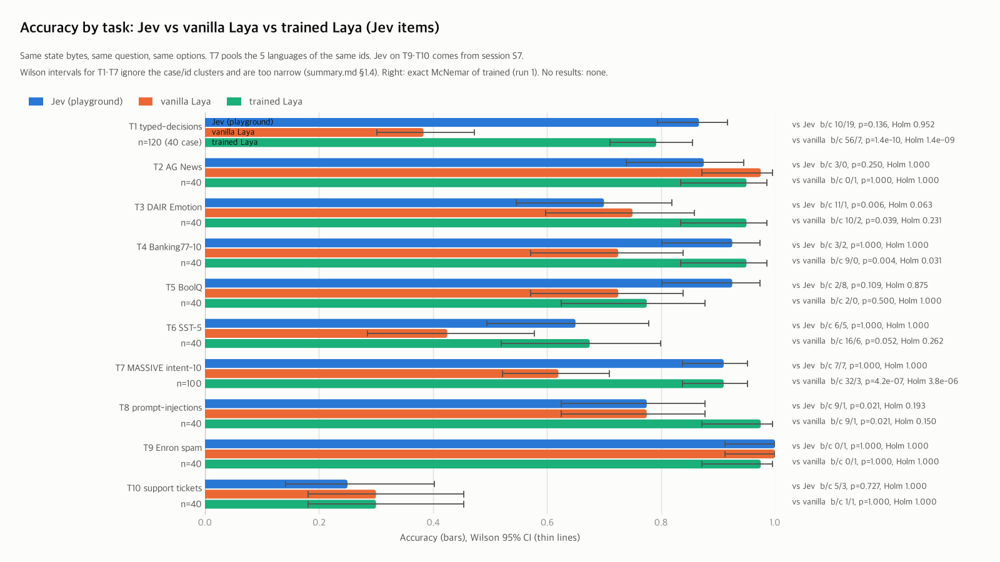
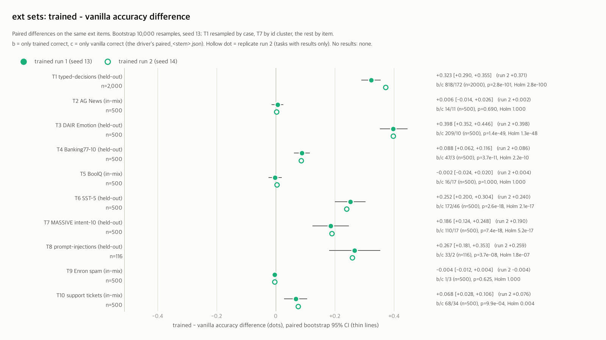
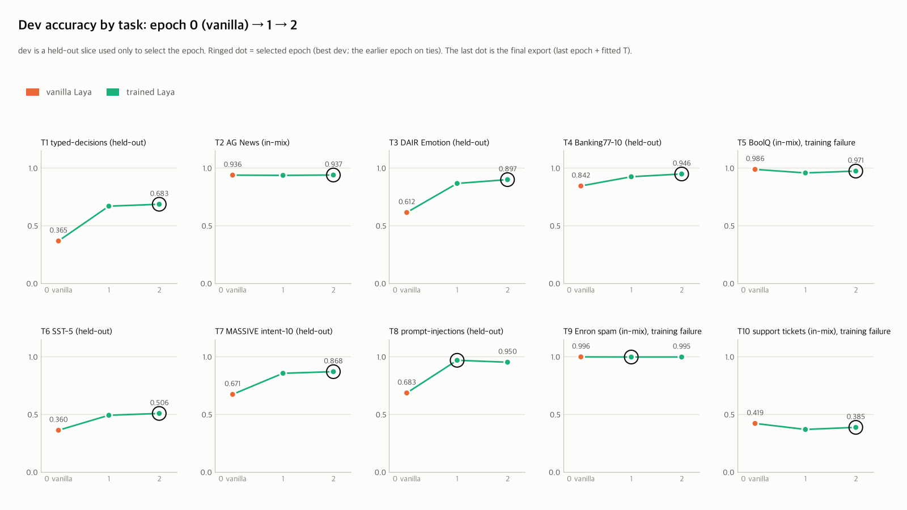
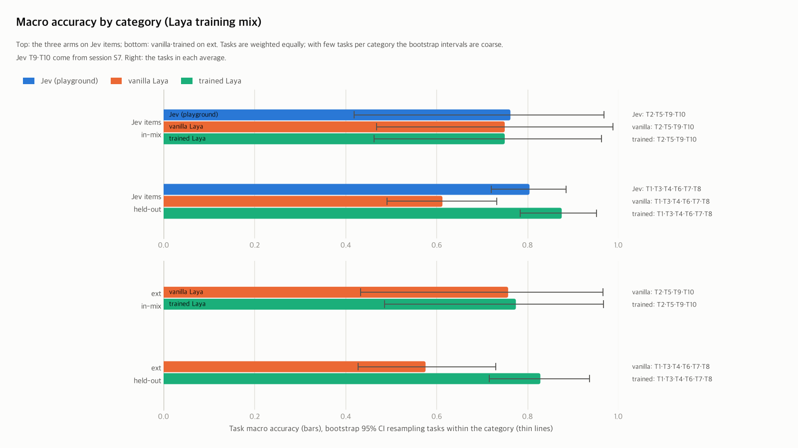

# 3-arm synthesis: Jev vs vanilla Laya vs trained Laya (S3, 2026-10-12 13:50)

> Jev is the record made through the independent 3rd-party playground (`results/F/jev_cmp/`; this synthesis makes no new requests). T1-T8 are the values of the F synthesis, and T9·T10 were computed with the same functions from the records (not included in the public repository) of session S7 (`results/F/jev_cmp/sessions/S7_20261008`). vanilla uses the same base as trained (english for the English tasks, multilingual for T7) without training. vanilla + task T is the calibration-separation column: vanilla with only a temperature fitted on the task calib added (§4). trained is Laya fine-tuned on task labels separately for each task, so this is a specialization comparison, not zero-shot (label counts and training time in §5). trained in §1-§6 is run 1 (the main training run), and the replicate run, run 2, is in §7. The numbers in this document equal `summary.json`, and `t3arm_summary.py verify` checks them against it.

**Status.** The last line of `results/T3arm/run_all_status.log` is `RUN_ALL FINISHED`. Tasks with results: 10 (T1, T2, T3, T4, T5, T6, T7, T8, T9, T10); without results: 0 (-). Tasks without results are shown as "no results" in the tables and left out of the tests and aggregates.

**Replicate run (§7).** The last line of `results/T3arm/rep_s14/run_all_status.log` is `RUN_ALL FINISHED`. Tasks with results: 10 (T1, T2, T3, T4, T5, T6, T7, T8, T9, T10); without results: 0 (-).

## 1. 3-arm comparison on the Jev items (Q2)

### 1.1 Summary table

| Task | Category | n | Jev | vanilla | trained | trained vs Jev: b/c, p (Holm p) | trained vs vanilla: b/c, p (Holm p) | Jev vs vanilla: b/c, p (Holm p) | Verdict (after Holm): trained vs Jev / trained vs vanilla / Jev vs vanilla |
|---|---|---|---|---|---|---|---|---|---|
| T1 typed-decisions | held-out | 120 (40 cases) | 104/120 = 0.867 [0.794, 0.916] | 46/120 = 0.383 [0.301, 0.473] | 95/120 = 0.792 [0.711, 0.855] | 10/19, 0.1360 (0.9523) | 56/7, 1.4e-10 (1.4e-09) | 66/8, 1.8e-12 (1.8e-11) | n.s. (n.s.) / trained significantly better (trained significantly better) / Jev significantly better (Jev significantly better) |
| T2 AG News | in-mix | 40 | 35/40 = 0.875 [0.739, 0.945] | 39/40 = 0.975 [0.871, 0.996] | 38/40 = 0.950 [0.835, 0.986] | 3/0, 0.2500 (1.0000) | 0/1, 1.0000 (1.0000) | 0/4, 0.1250 (0.6250) | n.s. (n.s.) / n.s. (n.s.) / n.s. (n.s.) |
| T3 DAIR Emotion | held-out | 40 | 28/40 = 0.700 [0.546, 0.819] | 30/40 = 0.750 [0.598, 0.858] | 38/40 = 0.950 [0.835, 0.986] | 11/1, 0.0063 (0.0635) | 10/2, 0.0386 (0.2314) | 2/4, 0.6875 (1.0000) | trained significantly better (n.s.) / trained significantly better (n.s.) / n.s. (n.s.) |
| T4 Banking77-10 | held-out | 40 | 37/40 = 0.925 [0.801, 0.974] | 29/40 = 0.725 [0.572, 0.839] | 38/40 = 0.950 [0.835, 0.986] | 3/2, 1.0000 (1.0000) | 9/0, 0.0039 (0.0312) | 9/1, 0.0215 (0.1719) | n.s. (n.s.) / trained significantly better (trained significantly better) / Jev significantly better (n.s.) |
| T5 BoolQ | in-mix | 40 | 37/40 = 0.925 [0.801, 0.974] | 29/40 = 0.725 [0.572, 0.839] | 31/40 = 0.775 [0.625, 0.877] | 2/8, 0.1094 (0.8750) | 2/0, 0.5000 (1.0000) | 9/1, 0.0215 (0.1719) | n.s. (n.s.) / n.s. (n.s.) / Jev significantly better (n.s.) |
| T6 SST-5 | held-out | 40 | 26/40 = 0.650 [0.495, 0.779] | 17/40 = 0.425 [0.285, 0.578] | 27/40 = 0.675 [0.520, 0.799] | 6/5, 1.0000 (1.0000) | 16/6, 0.0525 (0.2624) | 15/6, 0.0784 (0.4701) | n.s. (n.s.) / n.s. (n.s.) / n.s. (n.s.) |
| T7 MASSIVE intent-10 | held-out | 100 (20 ids x 5 languages) | 91/100 = 0.910 [0.838, 0.952] | 62/100 = 0.620 [0.522, 0.709] | 91/100 = 0.910 [0.838, 0.952] | 7/7, 1.0000 (1.0000) | 32/3, 4.2e-07 (3.8e-06) | 36/7, 9.0e-06 (8.1e-05) | n.s. (n.s.) / trained significantly better (trained significantly better) / Jev significantly better (Jev significantly better) |
| T8 prompt-injections | held-out | 40 | 31/40 = 0.775 [0.625, 0.877] | 31/40 = 0.775 [0.625, 0.877] | 39/40 = 0.975 [0.871, 0.996] | 9/1, 0.0215 (0.1934) | 9/1, 0.0215 (0.1504) | 5/5, 1.0000 (1.0000) | trained significantly better (n.s.) / trained significantly better (n.s.) / n.s. (n.s.) |
| T9 Enron spam | in-mix | 40 | 40/40 = 1.000 [0.912, 1.000] | 40/40 = 1.000 [0.912, 1.000] | 39/40 = 0.975 [0.871, 0.996] | 0/1, 1.0000 (1.0000) | 0/1, 1.0000 (1.0000) | 0/0, 1.0000 (1.0000) | n.s. (n.s.) / n.s. (n.s.) / n.s. (n.s.) |
| T10 support tickets | in-mix | 40 | 10/40 = 0.250 [0.142, 0.402] | 12/40 = 0.300 [0.181, 0.454] | 12/40 = 0.300 [0.181, 0.454] | 5/3, 0.7266 (1.0000) | 1/1, 1.0000 (1.0000) | 3/5, 0.7266 (1.0000) | n.s. (n.s.) / n.s. (n.s.) / n.s. (n.s.) |

- Difference from the earlier 8-task family: with the Jev results for T9·T10 (S7) added, Holm was redone for trained vs Jev over 8 → 10 tasks and for Jev vs vanilla over 8 → 10 tasks. No post-Holm verdict cell changed in T1-T8.
- An accuracy cell is correct/n = accuracy [Wilson 95%]. b = only the first arm correct, c = only the second arm correct, and p is the exact McNemar test (two-sided). Holm was applied separately per family (trained vs Jev 10 tasks, trained vs vanilla 10 tasks, Jev vs vanilla 10 tasks).
- The verdict rule is the same as in F. If p < 0.05 and b > c, the first arm is significantly better; if c > b, the second arm is significantly better; otherwise n.s. The parentheses give the result of applying the same rule to the Holm-corrected p.
- In the verdict column, trained vs Jev and trained vs vanilla are the verdicts of run 1 (the main training run). A verdict is confirmed only when the two runs reach the same conclusion (owner decision). Whether the two columns are confirmed is in §7.2. Jev vs vanilla does not involve training, so it is the same in both runs.
- For T1-T8, Jev vs vanilla reuses F's McNemar as is (the base runner in `results/F/jev_cmp/summary.json`: multilingual for T7, english for the rest). For T9·T10 it is a test of the base runner (english) computed from the S7 master records (not included in the public repository) with the same functions (`s6_summary.systems_boolean`·`systems_choice`·`mcn`). F's verdict is based on the best Laya runner per task, so it differs from this table on T4 (F's best is multilingual), and Holm was redone among the base-runner tests of this table.
- T1 uses only the decisions comparable with Jev (all 200 decisions of the Laya arms are in §1.2). In T1 (case) and T7 (id) the decisions are grouped into clusters, so the Wilson intervals and the item-level McNemar are optimistic. The cluster bootstrap is in §1.4.
- On the in-mix tasks vanilla has already seen the data, so trained − vanilla can come out small (retention cap, §3).

### 1.2 T1 typed-decisions: the 120 decisions compared with Jev and all 200 decisions

| arm | 120 decisions compared with Jev | soft acc | Brier vs soft | score MAE | all 200 decisions (Laya arms) | soft acc | Brier vs soft | score MAE |
|---|---|---|---|---|---|---|---|---|
| Jev | 104/120 = 0.867 [0.794, 0.916] | 0.590 | 0.077 | 0.390 | - | - | - | - |
| vanilla | 46/120 = 0.383 [0.301, 0.473] | 0.361 | 0.333 | 0.584 | 66/200 = 0.330 [0.269, 0.398] | 0.320 | 0.334 | 0.719 |
| trained | 95/120 = 0.792 [0.711, 0.855] | 0.515 | 0.104 | 0.254 | 137/200 = 0.685 [0.618, 0.745] | 0.458 | 0.113 | 0.368 |

- soft acc·Brier vs soft·score MAE are measured against the teacher distribution (upstream Part B, `laya_summary.py t1_extra`). The Jev row holds F's values.
- trained vs vanilla, all 200 decisions: b/c 85/14, p=1.4e-13, accuracy difference +0.355 (driver `paired_T1_typed_decisions_40.json`).

### 1.3 T7 MASSIVE intent-10: by language (the same 20 ids)

| arm | en | de | ja | zh-CN | ko | pooled |
|---|---|---|---|---|---|---|
| Jev | 18/20 = 0.900 | 18/20 = 0.900 | 19/20 = 0.950 | 18/20 = 0.900 | 18/20 = 0.900 | 91/100 = 0.910 [0.838, 0.952] |
| vanilla | 17/20 = 0.850 | 8/20 = 0.400 | 16/20 = 0.800 | 12/20 = 0.600 | 9/20 = 0.450 | 62/100 = 0.620 [0.522, 0.709] |
| trained | 19/20 = 0.950 | 17/20 = 0.850 | 19/20 = 0.950 | 18/20 = 0.900 | 18/20 = 0.900 | 91/100 = 0.910 [0.838, 0.952] |

- The options are 10 English keys, and only the utterances differ by language. n per language is small, so the differences between languages are directional signals.

### 1.4 Cluster bootstrap: T1 (case), T7 (id)

| Task | Comparison | Accuracy difference | Cluster bootstrap 95% | Clusters / decisions | For reference: item-level McNemar b/c, p |
|---|---|---|---|---|---|
| T1 | trained − Jev | −0.075 | [−0.185, +0.025] | 40 / 120 | 10/19, 0.1360 |
| T1 | trained − vanilla | +0.408 | [+0.304, +0.516] | 40 / 120 | 56/7, 1.4e-10 |
| T1 | Jev − vanilla | +0.483 | [+0.371, +0.597] | 40 / 120 | 66/8, 1.8e-12 |
| T7 | trained − Jev | +0.000 | [−0.100, +0.110] | 20 / 100 | 7/7, 1.0000 |
| T7 | trained − vanilla | +0.290 | [+0.150, +0.440] | 20 / 100 | 32/3, 4.2e-07 |
| T7 | Jev − vanilla | +0.290 | [+0.100, +0.470] | 20 / 100 | 36/7, 9.0e-06 |

- Clusters were resampled with replacement (10,000 resamples, seed 13), and the accuracy difference was recomputed over all decisions of the drawn clusters (`s6_summary.cluster_boot`). Jev − vanilla is F's value.

### 1.5 Secondary metrics (same definitions as docs/09)

| Task | Metric | Jev | vanilla | trained |
|---|---|---|---|---|
| T5 BoolQ | AUROC p(true) | 0.988 | 0.810 | 0.831 |
| T6 SST-5 | MAE of E[level] | 0.432 | 0.888 | 0.472 |
| T8 prompt-injections | AUROC p(true) | 1.000 | 0.929 | 1.000 |
| T9 Enron spam | AUROC p(true) | 1.000 | 1.000 | 1.000 |

- T1's soft acc·Brier vs soft·score MAE are in §1.2. AUROC is computed from the ranking of p(true) (ties count as half), and MAE is the absolute difference between the expected level and the gold level. The Jev values are F's values, and T9 was computed from the S7 records with the same function (probabilities rounded to the second decimal place; MAE uses Jev's score field).

### 1.6 T10 support tickets: label check (Jev items, 40 rows)

| Queue (gold) | Jev | vanilla english | vanilla multilingual (reference) | trained |
|---|---|---|---|---|
| Technical Support | 1/4 | 3/4 | 3/4 | 2/4 |
| Product Support | 0/4 | 0/4 | 2/4 | 0/4 |
| Customer Service | 0/4 | 0/4 | 0/4 | 0/4 |
| IT Support | 1/4 | 0/4 | 2/4 | 0/4 |
| Billing and Payments | 2/4 | 4/4 | 4/4 | 4/4 |
| Returns and Exchanges | 1/4 | 1/4 | 2/4 | 1/4 |
| Service Outages and Maintenance | 3/4 | 4/4 | 3/4 | 4/4 |
| Sales and Pre-Sales | 1/4 | 0/4 | 2/4 | 1/4 |
| Human Resources | 0/4 | 0/4 | 0/4 | 0/4 |
| General Inquiry | 1/4 | 0/4 | 0/4 | 0/4 |
| Total | 10/40 | 12/40 | 18/40 | 12/40 |

- The rows that all four systems (Jev, vanilla english, vanilla multilingual, trained) get wrong number 18/40. Without trained it is also 18/40, the same rows as in the per item table of S7 analyze (`raw/analyze/T10.md`, not included in the public repository).
- Label quality is suspect and needs a manual check (evidence: `S7_summary.md`). §3.6 of that document read most of the wrong answers as cases where the gold queue does not match the queue descriptions given in the question (interpretation). There are few rows per queue, so the per-queue numbers are directional signals. multilingual is a reference runner outside the 3-arm comparison (the T10 base is english).

## 2. ext set: vanilla vs trained

### 2.1 Per-task table

| Task | Category | n | vanilla | trained | trained − vanilla [bootstrap 95%] | b/c, p (Holm p) | Verdict (after Holm) |
|---|---|---|---|---|---|---|---|
| T1 typed-decisions | held-out | 2,000 | 727/2000 = 0.363 [0.343, 0.385] | 1373/2000 = 0.686 [0.666, 0.706] | +0.323 [+0.290, +0.355] | 818/172, 2.8e-101 (2.8e-100) | trained significantly better (trained significantly better) |
| T2 AG News | in-mix | 500 | 470/500 = 0.940 [0.916, 0.958] | 473/500 = 0.946 [0.923, 0.963] | +0.006 [−0.014, +0.026] | 14/11, 0.6900 (1.0000) | n.s. (n.s.) |
| T3 DAIR Emotion | held-out | 500 | 244/500 = 0.488 [0.444, 0.532] | 443/500 = 0.886 [0.855, 0.911] | +0.398 [+0.352, +0.446] | 209/10, 1.4e-49 (1.3e-48) | trained significantly better (trained significantly better) |
| T4 Banking77-10 | held-out | 500 | 438/500 = 0.876 [0.844, 0.902] | 482/500 = 0.964 [0.944, 0.977] | +0.088 [+0.062, +0.116] | 47/3, 3.7e-11 (2.2e-10) | trained significantly better (trained significantly better) |
| T5 BoolQ | in-mix | 500 | 417/500 = 0.834 [0.799, 0.864] | 416/500 = 0.832 [0.797, 0.862] | −0.002 [−0.024, +0.020] | 16/17, 1.0000 (1.0000) | n.s. (n.s.) |
| T6 SST-5 | held-out | 500 | 169/500 = 0.338 [0.298, 0.381] | 295/500 = 0.590 [0.546, 0.632] | +0.252 [+0.200, +0.304] | 172/46, 2.6e-18 (2.1e-17) | trained significantly better (trained significantly better) |
| T7 MASSIVE intent-10 | held-out | 500 | 346/500 = 0.692 [0.650, 0.731] | 439/500 = 0.878 [0.846, 0.904] | +0.186 [+0.124, +0.248] | 110/17, 7.4e-18 (5.2e-17) | trained significantly better (trained significantly better) |
| T8 prompt-injections | held-out | 116 | 81/116 = 0.698 [0.609, 0.774] | 112/116 = 0.966 [0.915, 0.987] | +0.267 [+0.181, +0.353] | 33/2, 3.7e-08 (1.8e-07) | trained significantly better (trained significantly better) |
| T9 Enron spam | in-mix | 500 | 496/500 = 0.992 [0.980, 0.997] | 494/500 = 0.988 [0.974, 0.994] | −0.004 [−0.012, +0.004] | 1/3, 0.6250 (1.0000) | n.s. (n.s.) |
| T10 support tickets | in-mix | 500 | 132/500 = 0.264 [0.227, 0.304] | 166/500 = 0.332 [0.292, 0.374] | +0.068 [+0.028, +0.106] | 68/34, 0.0010 (0.0039) | trained significantly better (trained significantly better) |

- Differences and intervals are from a paired bootstrap over the same items (10,000 resamples, seed 13). T1 resamples cases and T7 ids as clusters, and the other tasks resample items (`s6_summary.cluster_boot`).
- b = only trained correct, c = only vanilla correct. b/c and p are the values in the driver's `paired_<stem>.json`, and T7 is the sum over the 5 language files. Holm was applied over the 10 tasks.
- trained and the verdicts are from run 1 (the main training run). A verdict is confirmed only when the two runs reach the same conclusion (§7.2).
- ext is for narrow CIs on vanilla vs trained (no Jev). Most samples are label-stratified, so their distribution differs from that of upstream's published figures (`PREP_20261008.md` §5).

### 2.2 T1 typed-decisions test, 2,000 decisions (same metrics as V2)

| Model | accuracy (dataset label, upstream definition) | accuracy (argmax gold) | soft acc | Brier vs soft | ECE | score MAE | choice / noul / score |
|---|---|---|---|---|---|---|---|
| upstream `laya-typed-decisions` (V2 a) | 0.766 | 0.767 | 0.471 | 0.061 | 0.214 | 0.242 | 0.733 / 0.858 / 0.724 |
| preparation V2(b): T1 training with our pipeline | 0.747 | 0.746 | 0.495 | 0.059 | 0.148 | 0.253 | 0.732 / 0.832 / 0.693 |
| vanilla english | 0.361 | 0.363 | 0.331 | 0.316 | 0.173 | 0.694 | 0.290 / 0.488 / 0.325 |
| trained (main-run T1) | 0.690 | 0.686 | 0.463 | 0.099 | 0.112 | 0.359 | 0.700 / 0.782 / 0.605 |

- Published figure 0.766 (V2 a criterion ±0.02), V2 b criterion ≥ 0.562 and majority 0.461 (docs/11 §4). The vanilla english row must equal english in `V2_upstream_repro.json` (verify checks this).
- trained is T1 of the main training run (english base, epoch selected on the task dev). V2 b is the preparation run with the same settings.

## 3. Category aggregates (Q1, Q2)

The categories follow the Laya training mix as stated by upstream (docs/11 §2). In-mix is T2·T5·T9·T10 and held-out is T1·T3·T4·T6·T7·T8. In the aggregates that include Jev, the in-mix category is T2·T5·T9·T10.

### 3.1 Category macro accuracy per arm

| Basis | arm | in-mix macro [95%] | in-mix tasks | held-out macro [95%] | held-out tasks |
|---|---|---|---|---|---|
| Jev items | Jev | 0.762 [0.419, 0.969] | T2·T5·T9·T10 | 0.804 [0.721, 0.885] | T1·T3·T4·T6·T7·T8 |
| Jev items | vanilla | 0.750 [0.469, 0.988] | T2·T5·T9·T10 | 0.613 [0.491, 0.732] | T1·T3·T4·T6·T7·T8 |
| Jev items | trained | 0.750 [0.462, 0.963] | T2·T5·T9·T10 | 0.875 [0.784, 0.952] | T1·T3·T4·T6·T7·T8 |
| ext | vanilla | 0.758 [0.433, 0.966] | T2·T5·T9·T10 | 0.576 [0.428, 0.730] | T1·T3·T4·T6·T7·T8 |
| ext | trained | 0.774 [0.485, 0.967] | T2·T5·T9·T10 | 0.828 [0.716, 0.937] | T1·T3·T4·T6·T7·T8 |

### 3.2 Differences between arms and difference-in-differences

| Basis | Difference | in-mix mean [95%] | held-out mean [95%] | held-out − in-mix [95%] |
|---|---|---|---|---|
| Jev items | Jev − vanilla | +0.013 [−0.075, +0.138] | +0.191 [+0.054, +0.330] | +0.179 [−0.008, +0.356] |
| Jev items | trained − vanilla | +0.000 [−0.025, +0.031] | +0.262 [+0.212, +0.327] | +0.262 [+0.202, +0.333] |
| Jev items | trained − Jev | −0.013 [−0.100, +0.062] | +0.071 [−0.017, +0.163] | +0.083 [−0.035, +0.215] |
| ext | trained − vanilla | +0.017 [−0.003, +0.051] | +0.252 [+0.171, +0.328] | +0.235 [+0.147, +0.316] |

- **Q1 difference-in-differences** = held-out mean (Jev − vanilla) − in-mix mean (Jev − vanilla) = +0.179 [−0.008, +0.356] (Jev items). A positive value means vanilla's deficit is larger on the held-out tasks.
- The per-task accuracies (T1: the decisions compared with Jev; T7: pooled over languages) were averaged with equal weights. The intervals are percentiles from resampling tasks with replacement within each category (10,000 resamples, seed 13), and the contrasts are differences with the two categories resampled separately. There are few tasks per category (4 in the in-mix category with Jev), so these are descriptive statistics, not population inference.
- trained − vanilla on the in-mix tasks can be small to the extent that vanilla has already seen that data (retention cap).

## 4. Calibration

### 4.1 Jev items

| Task | arm | temperature source | Brier | ECE | coverage@error 5% | coverage@error 10% |
|---|---|---|---|---|---|---|
| T1 | Jev | - | 0.237 | 0.181 | 0.808 | 0.933 |
| T1 | vanilla | upstream fit (per format, per option-count bucket) | 0.724 | 0.205 | 0.000 | 0.000 |
| T1 | vanilla + task T | task calib fit (0-step export): choice 7.613 → 5.000, score 4.176, noul 10.000 → 5.000 | 0.656 | 0.129 | 0.000 | 0.000 |
| T1 | trained | task calib fit: choice 1.101, score 1.049, noul 1.091 | 0.353 | 0.180 | 0.525 | 0.592 |
| T2 | Jev | - | 0.220 | 0.118 | 0.800 | 0.875 |
| T2 | vanilla | upstream fit (per format, per option-count bucket) | 0.053 | 0.083 | 1.000 | 1.000 |
| T2 | vanilla + task T | task calib fit (0-step export): choice 1.475, score 1.200, noul 1.200 | 0.051 | 0.064 | 1.000 | 1.000 |
| T2 | trained | task calib fit: choice 4.487, score 1.200, noul 1.200 | 0.095 | 0.011 | 1.000 | 1.000 |
| T3 | Jev | - | 0.537 | 0.278 | 0.000 | 0.000 |
| T3 | vanilla | upstream fit (per format, per option-count bucket) | 0.429 | 0.174 | 0.175 | 0.400 |
| T3 | vanilla + task T | task calib fit (0-step export): choice 3.575, score 1.200, noul 1.200 | 0.428 | 0.209 | 0.250 | 0.625 |
| T3 | trained | task calib fit: choice 4.527, score 1.200, noul 1.200 | 0.093 | 0.074 | 1.000 | 1.000 |
| T4 | Jev | - | 0.114 | 0.069 | 0.900 | 1.000 |
| T4 | vanilla | upstream fit (per format, per option-count bucket) | 0.349 | 0.150 | 0.575 | 0.775 |
| T4 | vanilla + task T | task calib fit (0-step export): choice 1.162, score 1.200, noul 1.200 | 0.337 | 0.155 | 0.575 | 0.775 |
| T4 | trained | task calib fit: choice 3.599, score 1.200, noul 1.200 | 0.072 | 0.012 | 1.000 | 1.000 |
| T5 | Jev | - | 0.098 | 0.103 | 0.875 | 1.000 |
| T5 | vanilla | upstream fit (per format, per option-count bucket) | 0.393 | 0.190 | 0.125 | 0.125 |
| T5 | vanilla + task T | task calib fit (0-step export): choice 1.200, score 1.200, noul 1.108 | 0.447 | 0.229 | 0.125 | 0.125 |
| T5 | trained | task calib fit: choice 1.200, score 1.200, noul 4.820 | 0.411 | 0.190 | 0.075 | 0.550 |
| T6 | Jev | - | 0.502 | 0.184 | 0.225 | 0.350 |
| T6 | vanilla | upstream fit (per format, per option-count bucket) | 0.770 | 0.239 | 0.150 | 0.150 |
| T6 | vanilla + task T | task calib fit (0-step export): choice 1.200, score 3.826, noul 1.200 | 0.687 | 0.112 | 0.100 | 0.100 |
| T6 | trained | task calib fit: choice 1.200, score 1.751, noul 1.200 | 0.461 | 0.153 | 0.225 | 0.275 |
| T7 | Jev | - | 0.140 | 0.068 | 0.850 | 1.000 |
| T7 | vanilla | default 1.0 (all formats) | 0.584 | 0.216 | 0.280 | 0.400 |
| T7 | vanilla + task T | task calib fit (0-step export): choice 2.094, score 1.200, noul 1.200 | 0.525 | 0.083 | 0.240 | 0.340 |
| T7 | trained | task calib fit: choice 4.744, score 1.200, noul 1.200 | 0.173 | 0.074 | 0.850 | 1.000 |
| T8 | Jev | - | 0.307 | 0.194 | 0.675 | 0.800 |
| T8 | vanilla | upstream fit (per format, per option-count bucket) | 0.401 | 0.223 | 0.000 | 0.675 |
| T8 | vanilla + task T | task calib fit (0-step export): choice 1.200, score 1.200, noul 10.000 → 5.000 | 0.337 | 0.168 | 0.600 | 0.700 |
| T8 | trained | task calib fit: choice 1.200, score 1.200, noul 1.860 | 0.035 | 0.021 | 1.000 | 1.000 |
| T9 | Jev | - | 0.019 | 0.060 | 1.000 | 1.000 |
| T9 | vanilla | upstream fit (per format, per option-count bucket) | 0.005 | 0.014 | 1.000 | 1.000 |
| T9 | vanilla + task T | task calib fit (0-step export): choice 1.200, score 1.200, noul 1.077 | 0.001 | 0.004 | 1.000 | 1.000 |
| T9 | trained | task calib fit: choice 1.200, score 1.200, noul 4.345 | 0.029 | 0.026 | 1.000 | 1.000 |
| T10 | Jev | - | 1.319 | 0.623 | 0.000 | 0.000 |
| T10 | vanilla | upstream fit (per format, per option-count bucket) | 0.775 | 0.253 | 0.175 | 0.275 |
| T10 | vanilla + task T | task calib fit (0-step export): choice 1.835, score 1.200, noul 1.200 | 0.733 | 0.162 | 0.175 | 0.250 |
| T10 | trained | task calib fit: choice 1.426, score 1.200, noul 1.200 | 0.752 | 0.184 | 0.125 | 0.125 |

### 4.2 ext

| Task | arm | temperature source | Brier | ECE | coverage@error 5% | coverage@error 10% |
|---|---|---|---|---|---|---|
| T1 | vanilla | upstream fit (per format, per option-count bucket) | 0.749 | 0.173 | 0.000 | 0.000 |
| T1 | vanilla + task T | task calib fit (0-step export): choice 7.613 → 5.000, score 4.176, noul 10.000 → 5.000 | 0.685 | 0.035 | 0.001 | 0.001 |
| T1 | trained | task calib fit: choice 1.101, score 1.049, noul 1.091 | 0.434 | 0.112 | 0.172 | 0.275 |
| T2 | vanilla | upstream fit (per format, per option-count bucket) | 0.096 | 0.032 | 0.974 | 1.000 |
| T2 | vanilla + task T | task calib fit (0-step export): choice 1.475, score 1.200, noul 1.200 | 0.096 | 0.020 | 0.976 | 1.000 |
| T2 | trained | task calib fit: choice 4.487, score 1.200, noul 1.200 | 0.097 | 0.013 | 0.988 | 1.000 |
| T3 | vanilla | upstream fit (per format, per option-count bucket) | 0.894 | 0.411 | 0.000 | 0.000 |
| T3 | vanilla + task T | task calib fit (0-step export): choice 3.575, score 1.200, noul 1.200 | 0.666 | 0.074 | 0.000 | 0.000 |
| T3 | trained | task calib fit: choice 4.527, score 1.200, noul 1.200 | 0.196 | 0.077 | 0.812 | 0.954 |
| T4 | vanilla | upstream fit (per format, per option-count bucket) | 0.211 | 0.074 | 0.732 | 0.940 |
| T4 | vanilla + task T | task calib fit (0-step export): choice 1.162, score 1.200, noul 1.200 | 0.212 | 0.077 | 0.738 | 0.942 |
| T4 | trained | task calib fit: choice 3.599, score 1.200, noul 1.200 | 0.061 | 0.015 | 1.000 | 1.000 |
| T5 | vanilla | upstream fit (per format, per option-count bucket) | 0.256 | 0.083 | 0.462 | 0.762 |
| T5 | vanilla + task T | task calib fit (0-step export): choice 1.200, score 1.200, noul 1.108 | 0.291 | 0.137 | 0.460 | 0.762 |
| T5 | trained | task calib fit: choice 1.200, score 1.200, noul 4.820 | 0.295 | 0.128 | 0.174 | 0.696 |
| T6 | vanilla | upstream fit (per format, per option-count bucket) | 0.863 | 0.313 | 0.002 | 0.002 |
| T6 | vanilla + task T | task calib fit (0-step export): choice 1.200, score 3.826, noul 1.200 | 0.724 | 0.087 | 0.002 | 0.002 |
| T6 | trained | task calib fit: choice 1.200, score 1.751, noul 1.200 | 0.530 | 0.074 | 0.018 | 0.022 |
| T7 | vanilla | default 1.0 (all formats) | 0.490 | 0.187 | 0.296 | 0.520 |
| T7 | vanilla + task T | task calib fit (0-step export): choice 2.094, score 1.200, noul 1.200 | 0.436 | 0.094 | 0.286 | 0.464 |
| T7 | trained | task calib fit: choice 4.744, score 1.200, noul 1.200 | 0.196 | 0.050 | 0.802 | 0.962 |
| T8 | vanilla | upstream fit (per format, per option-count bucket) | 0.526 | 0.262 | 0.000 | 0.000 |
| T8 | vanilla + task T | task calib fit (0-step export): choice 1.200, score 1.200, noul 10.000 → 5.000 | 0.439 | 0.207 | 0.440 | 0.586 |
| T8 | trained | task calib fit: choice 1.200, score 1.200, noul 1.860 | 0.057 | 0.034 | 1.000 | 1.000 |
| T9 | vanilla | upstream fit (per format, per option-count bucket) | 0.014 | 0.006 | 1.000 | 1.000 |
| T9 | vanilla + task T | task calib fit (0-step export): choice 1.200, score 1.200, noul 1.077 | 0.014 | 0.006 | 1.000 | 1.000 |
| T9 | trained | task calib fit: choice 1.200, score 1.200, noul 4.345 | 0.018 | 0.005 | 1.000 | 1.000 |
| T10 | vanilla | upstream fit (per format, per option-count bucket) | 0.851 | 0.201 | 0.102 | 0.122 |
| T10 | vanilla + task T | task calib fit (0-step export): choice 1.835, score 1.200, noul 1.200 | 0.801 | 0.088 | 0.104 | 0.126 |
| T10 | trained | task calib fit: choice 1.426, score 1.200, noul 1.200 | 0.757 | 0.054 | 0.146 | 0.156 |

- Brier is the mean of Σ(p − onehot)² over all options, and ECE uses 15 bins of top p. coverage@error x% is the largest coverage whose error rate stays at or below x% when decisions are accepted in descending order of top p (`scripts/metrics_extra.py coverage_table`; equal confidences are not split). Jev's probabilities are rounded to the second decimal place, so Brier·ECE carry an error floor of about ±0.005.
- **Caution.** trained's calibration improvement mixes in a temperature refit effect (V1). trained's temperature is refit on the task calib, while vanilla english uses upstream's fitted values and multilingual the default. In V1, refit alone, without training, moved ECE english 0.083 → 0.064 and multilingual 0.365 → 0.179. The vanilla + task T rows and §4.3 separate this effect per task. The accuracy comparison is unaffected (temperature does not change the argmax).
- vanilla + task T is a 0-step export that keeps the base weights and only fits the temperature on that task's calib (`results/T3arm/calib_sep/<task>/`, the same procedure as V1, owner decision 3). In the temperature source, a → b is a clamp: laya clipped the fitted value a to b when loading (`temperature_raw` → `temperature_applied` in the report's `config.checkpoint`; tasks affected: T1, T8).

### 4.3 Calibration separation: refit effect and training effect

| Task | Jev items ECE: refit / training | Jev items Brier: refit / training | ext ECE: refit / training | ext Brier: refit / training |
|---|---|---|---|---|
| T1 typed-decisions | −0.076 / +0.051 | −0.067 / −0.303 | −0.138 / +0.077 | −0.064 / −0.250 |
| T2 AG News | −0.019 / −0.052 | −0.002 / +0.043 | −0.012 / −0.006 | −0.000 / +0.001 |
| T3 DAIR Emotion | +0.034 / −0.135 | −0.002 / −0.334 | −0.336 / +0.002 | −0.228 / −0.470 |
| T4 Banking77-10 | +0.005 / −0.143 | −0.012 / −0.265 | +0.004 / −0.063 | +0.001 / −0.151 |
| T5 BoolQ | +0.039 / −0.039 | +0.054 / −0.036 | +0.055 / −0.010 | +0.035 / +0.003 |
| T6 SST-5 | −0.127 / +0.041 | −0.084 / −0.226 | −0.226 / −0.013 | −0.139 / −0.194 |
| T7 MASSIVE intent-10 | −0.133 / −0.009 | −0.060 / −0.352 | −0.093 / −0.045 | −0.054 / −0.240 |
| T8 prompt-injections | −0.055 / −0.147 | −0.065 / −0.302 | −0.055 / −0.173 | −0.087 / −0.382 |
| T9 Enron spam | −0.010 / +0.022 | −0.004 / +0.029 | +0.000 / −0.001 | +0.000 / +0.003 |
| T10 support tickets | −0.091 / +0.022 | −0.042 / +0.019 | −0.113 / −0.034 | −0.050 / −0.045 |

- refit effect = (vanilla + task T) − vanilla, training effect = trained − (vanilla + task T). Their sum is trained − vanilla, and a negative value means that metric went down (improved). For T1, the Jev items are the 120 decisions comparable with Jev.
- The answers of vanilla + task T are the same as vanilla's. argmax agrees on 6,735/6,736 (6,736/6,736 if rounding ties count as the same answer), and correctness agrees on 6,736/6,736 (`same_<stem>.json`, Jev items and all of ext). So accuracy and the accuracy tests are the vanilla cells as they are, and only Brier·ECE·coverage differ. The 1 decision with a strict mismatch (`T6_sst5_ext500`) agrees if ties count as the same answer.

## 5. Cost (Q3)

| Task | base | Total labels | train items | calib | dev | epoch / optimizer step | item source (training: item-pass count) | train loop (min) | run_ft wall (min) | items/s | MPS allocated / driver peak (GB) | Checkpoint (GB) |
|---|---|---|---|---|---|---|---|---|---|---|---|---|
| T1 typed-decisions | english | 6,000 | 5,000 | 400 | 600 | 2 / 314 | train ← train 10,000; calibration ← calib 400 | 39.9 | 40.4 | 4.18 | 20.7 / 30.2 | 0.85 |
| T2 AG News | english | 6,400 | 5,000 | 400 | 1,000 | 2 / 314 | train ← train 10,000; calibration ← calib 400 | 14.4 | 14.6 | 11.61 | 15.2 / 21.6 | 0.85 |
| T3 DAIR Emotion | english | 6,400 | 5,000 | 400 | 1,000 | 2 / 314 | train ← train 10,000; calibration ← calib 400 | 10.1 | 10.3 | 16.53 | 8.8 / 16.2 | 0.85 |
| T4 Banking77-10 | english | 6,400 | 5,000 | 400 | 1,000 | 2 / 314 | train ← train 10,000; calibration ← calib 400 | 11.6 | 11.8 | 14.37 | 9.7 / 18.4 | 0.85 |
| T5 BoolQ | english | 6,400 | 5,000 | 400 | 1,000 | 2 / 314 | train ← train 10,000; calibration ← calib 400 | 28.3 | 28.7 | 5.89 | 20.7 / 26.2 | 0.85 |
| T6 SST-5 | english | 6,100 | 5,000 | 400 | 700 | 2 / 314 | train ← train 10,000; calibration ← calib 400 | 11.4 | 11.6 | 14.58 | 9.1 / 17.7 | 0.85 |
| T7 MASSIVE intent-10 | multilingual | 6,400 | 5,000 | 400 | 1,000 | 2 / 314 | train ← train 10,000; calibration ← calib 400 | 7.5 | 7.7 | 22.10 | 6.7 / 15.9 | 0.68 |
| T8 prompt-injections | english | 544 | 444 | 40 | 60 | 2 / 28 | train ← train 888; calibration ← calib 40 | 1.4 | 1.5 | 10.48 | 20.8 / 26.0 | 0.85 |
| T9 Enron spam | english | 6,400 | 5,000 | 400 | 1,000 | 2 / 314 | train ← train 10,000; calibration ← calib 400 | 43.3 | 43.9 | 3.85 | 20.7 / 32.3 | 0.85 |
| T10 support tickets | english | 6,400 | 5,000 | 400 | 1,000 | 2 / 314 | train ← train 10,000; calibration ← calib 400 | 26.8 | 27.2 | 6.21 | 18.1 / 22.7 | 0.85 |

- Total labels = train + calib (temperature fit) + dev (epoch selection). Time and memory are from the run_ft report (`<task>/train_timing.json`; training is MPS fp32), and the checkpoint size is the total file size (decimal GB) of `poc/finetune/ckpt_t3arm/<task>/` (not included in the public repository). Jev and vanilla have no labels and no training.

## 6. Training validation (Q4)

### 6.1 Per-task diagnostics

| Task | dev epoch 0 (vanilla) | epoch 1 | epoch 2 | Selected epoch | train − dev | fitted T (choice, score, noul) | clamp | flip dev40 [95%] | Class recall change (up / down / same; lowest, highest) | Training failure |
|---|---|---|---|---|---|---|---|---|---|---|
| T1 typed-decisions | 0.365 | 0.667 | 0.683 | 2 | +0.054 | 1.101, 1.049, 1.091 | none | 0.031 [0.000, 0.069] (n=58) | 30 / 10 / 14; disposition=close_benign −1.000, disposition=investigate +1.000 | no |
| T2 AG News | 0.936 | 0.934 | 0.937 | 2 | +0.027 | 4.487, 1.200, 1.200; default formats: score, noul | none | 0.005 [0.000, 0.015] (n=40) | 1 / 2 / 1; business −0.016, sci_tech +0.024 | no |
| T3 DAIR Emotion | 0.612 | 0.864 | 0.897 | 2 | +0.034 | 4.527, 1.200, 1.200; default formats: score, noul | none | 0.015 [0.000, 0.040] (n=40) | 6 / 0 / 0; joy +0.176, surprise +0.600 | no |
| T4 Banking77-10 | 0.842 | 0.922 | 0.946 | 2 | +0.013 | 3.599, 1.200, 1.200; default formats: score, noul | none | 0.035 [0.000, 0.095] (n=40) | 47 / 7 / 23; cash withdrawal charge −0.154, get physical card +0.615 | no |
| T5 BoolQ | 0.986 | 0.955 | 0.971 | 2 | +0.009 | 1.200, 1.200, 4.820; default formats: choice, score | none | - (not choice) | 0 / 2 / 0; True −0.016, False −0.014 | yes |
| T6 SST-5 | 0.360 | 0.490 | 0.506 | 2 | +0.142 | 1.200, 1.751, 1.200; default formats: choice, noul | none | - (not choice) | 3 / 2 / 0; 1 −0.148, 4 +0.635 | no |
| T7 MASSIVE intent-10 | 0.671 | 0.854 | 0.868 | 2 | +0.069 | 4.744, 1.200, 1.200; default formats: score, noul | none | 0.010 [0.000, 0.025] (n=40) | 46 / 3 / 8; play_music −0.250, recommendation_events +0.667 | no |
| T8 prompt-injections | 0.683 | 0.967 | 0.950 | 1 (recalibrated) | +0.033 | 1.200, 1.200, 1.860; default formats: choice, score | none | - (not choice) | 1 / 0 / 1; False +0.000, True +0.567 | no |
| T9 Enron spam | 0.996 | 0.995 | 0.995 | 1 (recalibrated) | −0.001 | 1.200, 1.200, 4.345; default formats: choice, score | none | - (not choice) | 1 / 1 / 0; True −0.008, False +0.006 | yes |
| T10 support tickets | 0.419 | 0.367 | 0.385 | 2 | +0.083 | 1.426, 1.200, 1.200; default formats: score, noul | none | 0.175 [0.105, 0.250] (n=40) | 7 / 1 / 0; Technical Support −0.477, Returns and Exchanges +0.191 | yes |

- dev is a held-out slice used only for epoch selection. The last-epoch cell is the final export (last epoch + fitted T), and temperature does not change the argmax. The selection rule is the highest dev, with ties going to the earlier epoch (docs/11 §4). When an earlier epoch is selected, the temperature is refit on the same calib (recalibration).
- train − dev = train accuracy over the last window (training forward with dropout on) − dev accuracy of the selected epoch. fitted T is the value of the selected checkpoint, and default formats are the formats with no calib samples, which got the script default. clamp lists values at the boundaries of the fit range and values outside the load range (the interval laya clips to when loading).
- flip is the rate of answer changes per permutation of the option order on the first 40 dev rows (choice tasks). Training failure = the dev of every epoch is below epoch 0 (vanilla).
- T5's training-failure flag: dev comes from the BoolQ train split, and BoolQ is in upstream's training mix. vanilla remembers those rows, which inflated the dev baseline. On the validation-based ext, vanilla and trained are the same (§2.1). Not a pipeline failure (the "Found during the main training run" section of `PREP_20261008.md`).
- T9's training-failure flag: a ceiling effect. The dev difference is 1 row out of 1,000, and vanilla's dev and ext are almost the same, so there is no memorization signal. Not a pipeline failure (the "Found during the main training run" section of `PREP_20261008.md`).
- T10's training-failure flag: dev has the natural distribution, so Technical Support has the largest share, while train·ext are close to balanced. vanilla's predictions are skewed toward this queue. trained raises recall on 7 of the 8 queues in dev, and dev macro recall also rises. Not a pipeline failure (the "Found during the main training run" section of `PREP_20261008.md`).

### 6.2 Training validation V1-V6 summary

| ID | Check | Key numbers | Criterion met | File (`results/T3arm/validity/`) |
|---|---|---|---|---|
| V1 | zero-step identity | english tensor values 206/206 identical, argmax 40/40, answers with base T restored 40/40 identical; multilingual tensor values 170/170 identical, argmax 20/20, answers with base T restored 20/20 identical. Refit alone: ECE english 0.083 → 0.064, multilingual 0.365 → 0.179 | yes | `V1_*_{export_diff,same,basetemp_same}.json` |
| V2 | upstream reproduction | (a) upstream checkpoint 0.766 (published 0.766, ±0.02) (b) our training 0.747 (criterion ≥ 0.562, majority 0.461) | yes | `V2_upstream_repro.json` |
| V3 | label-shuffle | permuted 0.385, real labels (preparation run) 0.831, vanilla 0.612, majority 0.296 | pass (owner verdict, §6.3) | `V3_label_shuffle.json` |
| V4 | format identity | 10 tasks, inference sequence and token match 250/250, option decode·target check 49,084 items | yes | `V4_format_identity.json` |
| V5 | smoke | english 3.95 items/s, multilingual 20.14 items/s. driver SMOKE STEP OK 163, FAILED 0 (`results/T3arm/smoke_20261008-1021/run_all_status.log`) | yes | `V5_*` |
| V6 | leakage | 10 tasks, intersection of train·dev·calib with the evaluation texts: exact 0 / normalized 0. Removed before extraction: T3 1, T7 24 | yes | `V6_leakage.json` |

- The criteria are docs/11 §4. Whether V1-V2·V4-V6 meet the criteria was recomputed from the numbers above and must match the verdicts in §3 of `PREP_20261008.md`. V3 is the owner's verdict (§6.3).

### 6.3 V3 numbers for the redone verdict, and the owner's verdict

| Criterion | Condition | Value | Threshold | Value − threshold |
|---|---|---|---|---|
| (a) strict | permuted ≤ majority + 0.05 | permuted 0.385 | 0.346 | +0.039 |
| (b) difference | real labels epoch 1 − permuted ≥ 0.30 | 0.864 − 0.385 = +0.479 | 0.30 | +0.179 |
| (c) alternative | permuted < vanilla zero-shot dev, and (b) | vanilla 0.612 − permuted 0.385 = +0.227; (b) difference +0.479 | above 0, (b) | - |

- **Owner verdict (2026-10-08, based on the main-training-run numbers): pass.** The (b) difference criterion and the (c) alternative criterion are met, and the +0.039 shortfall on the (a) strict criterion is recorded as a deviation from the plan (`PREP_20261008.md "Owner decision" 1`).
- real labels epoch 1 = the `dev_ep1.json` accuracy of main-run T3 (0.864; the midpoint of a 2-epoch cosine). The control run of the preparation stage (same items, cosine ending within one epoch) was 0.831.
- permuted, majority and vanilla are from `V3_label_shuffle.json` (all of T3 dev, english). The dev epoch 0 (vanilla) of main-run T3 is 0.612 (on the same dev it must equal vanilla).

### 6.4 Spread between T1 retrainings with the same settings

The preparation V2(b) and main-run T1 have the same script, items, seed and arguments (`PREP_20261008.md`, last section). The cause is that MPS training is not bit-level deterministic. The micro-batch losses of the two runs first diverge at micro-batch 12 (1.20023 vs 1.20035).

| Metric | V2(b) (preparation) | main-run T1 |
|---|---|---|
| dev epoch 1 | 0.708 | 0.667 |
| dev epoch 2 | 0.738 | 0.683 |
| test accuracy (dataset label, upstream definition) | 0.747 | 0.690 |
| test accuracy (argmax gold) | 0.746 | 0.686 |
| test soft acc | 0.495 | 0.463 |
| test Brier vs soft | 0.059 | 0.099 |
| test score MAE | 0.253 | 0.359 |
| test ECE | 0.148 | 0.112 |
| calibration-row accuracy | 0.718 | 0.685 |
| last train CE window | 0.864 | 0.930 |

| Paired comparison (test 2,000 decisions) | b/c | exact McNemar p | Accuracy difference V2(b) − main run (argmax gold) | case cluster bootstrap 95% | Clusters / decisions |
|---|---|---|---|---|---|
| V2(b) vs main run | 217/98 | 1.7e-11 | +0.059 | [+0.040, +0.081] | 400 / 2000 |

| micro-batch loss (ce) | 0-11 | 12-39 | 40-99 | 100-299 | 300-624 | 625-1249 |
|---|---|---|---|---|---|---|
| Mean absolute difference between the two runs | 0.0000 | 0.0159 | 0.0248 | 0.0536 | 0.0653 | 0.0823 |

- b = only V2(b) correct, c = only the main run correct (same decisions). The cluster bootstrap resampled cases with replacement (10,000 resamples, seed 13) (`s6_summary.cluster_boot`).
- The loss intervals are micro-batch indices (1250 over the two epochs). The values are the fifth field (ce) of `micro_batch_trace` in each run's `train_timing.json`.
- Even with the same settings, results vary from one training run to the next. So the trained numbers in §1-§6 are a sample of one run (run 1). The replicate run with a different seed and the confirmation of verdicts are in §7, and the comparison of the three T1 runs is in §7.4.

## 7. Replicate run and confirmation of verdicts

run 1 is the main training run (torch seed 13, `results/T3arm/<task>/`), and run 2 is the replicate run with the same settings and only the seed changed to 14 (`results/T3arm/rep_s14/<task>/`). The data order is the same; the seed changes the dropout and RLCD noise (`PREP_20261008.md` "Owner decision" 4). A verdict is confirmed only when the two runs reach the same conclusion. run 2 tasks with results: 10 (T1, T2, T3, T4, T5, T6, T7, T8, T9, T10); without results: 0 (-). vanilla·Jev·vanilla + task T involve no training, so they are the same in both runs.

### 7.1 Per-task accuracy and paired comparison of the two runs

| Task | Category | Jev-item accuracy: run 1 / run 2 / mean | ext accuracy: run 1 / run 2 / mean | ext run 1 vs run 2: b/c, p | Selected epoch: run 1 / run 2 |
|---|---|---|---|---|---|
| T1 typed-decisions | held-out | 0.792 / 0.858 / 0.825 | 0.686 / 0.735 / 0.711 | 117/214, 1.1e-07; cluster bootstrap run 1 − run 2 −0.049 [−0.069, −0.028] | 2 / 2 |
| T2 AG News | in-mix | 0.950 / 0.975 / 0.962 | 0.946 / 0.942 / 0.944 | 12/10, 0.8318 | 2 / 1 |
| T3 DAIR Emotion | held-out | 0.950 / 0.925 / 0.938 | 0.886 / 0.886 / 0.886 | 11/11, 1.0000 | 2 / 2 |
| T4 Banking77-10 | held-out | 0.950 / 0.925 / 0.938 | 0.964 / 0.962 / 0.963 | 9/8, 1.0000 | 2 / 2 |
| T5 BoolQ | in-mix | 0.775 / 0.700 / 0.738 | 0.832 / 0.838 / 0.835 | 21/24, 0.7660 | 2 / 2 |
| T6 SST-5 | held-out | 0.675 / 0.725 / 0.700 | 0.590 / 0.578 / 0.584 | 38/32, 0.5504 | 2 / 2 |
| T7 MASSIVE intent-10 | held-out | 0.910 / 0.870 / 0.890 | 0.878 / 0.882 / 0.880 | 16/18, 0.8642; cluster bootstrap run 1 − run 2 −0.004 [−0.032, +0.024] | 2 / 2 |
| T8 prompt-injections | held-out | 0.975 / 1.000 / 0.988 | 0.966 / 0.957 / 0.961 | 2/1, 1.0000 | 1 / 2 |
| T9 Enron spam | in-mix | 0.975 / 0.975 / 0.975 | 0.988 / 0.988 / 0.988 | 2/2, 1.0000 | 1 / 2 |
| T10 support tickets | in-mix | 0.300 / 0.425 / 0.362 | 0.332 / 0.340 / 0.336 | 33/37, 0.7202 | 2 / 2 |

- Accuracy is trained's accuracy (Jev items: the same decisions as §1.1; mean: the simple mean of the two runs). b = only run 1 correct, c = only run 2 correct (same ext items), and p is the exact McNemar test.
- In T1·T7 the decisions are grouped into case·id clusters, so the item-level p is optimistic; the cluster bootstrap of the run 1 − run 2 accuracy difference (10,000 resamples, bootstrap seed 13) is given alongside.
- §6.4 is the spread between two runs with the same seed (preparation V2(b), main training run) that diverged through MPS nondeterminism alone. run 2 also changed the seed.

### 7.2 Decision agreement table

| Task | Comparison | run 1 verdict (Holm p) | run 2 verdict (Holm p) | Conclusion |
|---|---|---|---|---|
| T1 typed-decisions | Jev items trained vs Jev | n.s. (0.9523) | n.s. (1.0000) | confirmed |
| T1 typed-decisions | Jev items trained vs vanilla | trained significantly better (1.4e-09) | trained significantly better (1.3e-11) | confirmed |
| T1 typed-decisions | ext trained vs vanilla | trained significantly better (2.8e-100) | trained significantly better (1.6e-128) | confirmed |
| T2 AG News | Jev items trained vs Jev | n.s. (1.0000) | n.s. (0.7500) | confirmed |
| T2 AG News | Jev items trained vs vanilla | n.s. (1.0000) | n.s. (1.0000) | confirmed |
| T2 AG News | ext trained vs vanilla | n.s. (1.0000) | n.s. (1.0000) | confirmed |
| T3 DAIR Emotion | Jev items trained vs Jev | n.s. (0.0635) | n.s. (0.1797) | confirmed |
| T3 DAIR Emotion | Jev items trained vs vanilla | n.s. (0.2314) | n.s. (0.3271) | confirmed |
| T3 DAIR Emotion | ext trained vs vanilla | trained significantly better (1.3e-48) | trained significantly better (1.3e-48) | confirmed |
| T4 Banking77-10 | Jev items trained vs Jev | n.s. (1.0000) | n.s. (1.0000) | confirmed |
| T4 Banking77-10 | Jev items trained vs vanilla | trained significantly better (0.0312) | n.s. (0.0547) | inconsistent |
| T4 Banking77-10 | ext trained vs vanilla | trained significantly better (2.2e-10) | trained significantly better (4.2e-09) | confirmed |
| T5 BoolQ | Jev items trained vs Jev | n.s. (0.8750) | n.s. (0.1055) | confirmed |
| T5 BoolQ | Jev items trained vs vanilla | n.s. (1.0000) | n.s. (1.0000) | confirmed |
| T5 BoolQ | ext trained vs vanilla | n.s. (1.0000) | n.s. (1.0000) | confirmed |
| T6 SST-5 | Jev items trained vs Jev | n.s. (1.0000) | n.s. (1.0000) | confirmed |
| T6 SST-5 | Jev items trained vs vanilla | n.s. (0.2624) | n.s. (0.0709) | confirmed |
| T6 SST-5 | ext trained vs vanilla | trained significantly better (2.1e-17) | trained significantly better (3.4e-15) | confirmed |
| T7 MASSIVE intent-10 | Jev items trained vs Jev | n.s. (1.0000) | n.s. (1.0000) | confirmed |
| T7 MASSIVE intent-10 | Jev items trained vs vanilla | trained significantly better (3.8e-06) | trained significantly better (4.2e-05) | confirmed |
| T7 MASSIVE intent-10 | ext trained vs vanilla | trained significantly better (5.2e-17) | trained significantly better (1.7e-18) | confirmed |
| T8 prompt-injections | Jev items trained vs Jev | n.s. (0.1934) | trained significantly better (0.0391) | inconsistent |
| T8 prompt-injections | Jev items trained vs vanilla | n.s. (0.1504) | trained significantly better (0.0312) | inconsistent |
| T8 prompt-injections | ext trained vs vanilla | trained significantly better (1.8e-07) | trained significantly better (7.7e-08) | confirmed |
| T9 Enron spam | Jev items trained vs Jev | n.s. (1.0000) | n.s. (1.0000) | confirmed |
| T9 Enron spam | Jev items trained vs vanilla | n.s. (1.0000) | n.s. (1.0000) | confirmed |
| T9 Enron spam | ext trained vs vanilla | n.s. (1.0000) | n.s. (1.0000) | confirmed |
| T10 support tickets | Jev items trained vs Jev | n.s. (1.0000) | n.s. (0.6460) | confirmed |
| T10 support tickets | Jev items trained vs vanilla | n.s. (1.0000) | n.s. (0.5000) | confirmed |
| T10 support tickets | ext trained vs vanilla | trained significantly better (0.0039) | trained significantly better (0.0015) | confirmed |

- Conclusion: confirmed 27, inconsistent 3, no results 0 (30 comparisons = 10 tasks x 3 comparison types). Inconsistent: T4 Jev items trained vs vanilla, T8 Jev items trained vs Jev, T8 Jev items trained vs vanilla.
- confirmed = the post-Holm verdicts of the two runs are the same. The verdict rule and the Holm families (separately per comparison) are the same as in §1.1·§2.1, and Holm for run 2 was done separately among the tasks with results in run 2 (now 10 tasks, 10 tasks when finished).

### 7.3 Category aggregates: ext trained − vanilla

| run | in-mix mean [95%] | in-mix tasks | held-out mean [95%] | held-out tasks | held-out − in-mix [95%] |
|---|---|---|---|---|---|
| run 1 (seed 13) | +0.017 [−0.003, +0.051] | T2·T5·T9·T10 | +0.252 [+0.171, +0.328] | T1·T3·T4·T6·T7·T8 | +0.235 [+0.147, +0.316] |
| run 2 (seed 14) | +0.020 [−0.002, +0.058] | T2·T5·T9·T10 | +0.257 [+0.169, +0.340] | T1·T3·T4·T6·T7·T8 | +0.238 [+0.144, +0.325] |

- Same method as §3.2 (tasks averaged with equal weights, bootstrap resampling tasks within each category, 10,000 resamples). held-out − in-mix is the difference-in-differences. run 2 includes only the tasks with results, so its task set can differ from run 1's.

### 7.4 The three T1 runs: preparation V2(b), main training run, run 2

| Metric | V2(b) (preparation, seed 13) | main training run, run 1 (seed 13) | run 2 (seed 14) |
|---|---|---|---|
| dev epoch 1 | 0.708 | 0.667 | 0.702 |
| dev epoch 2 | 0.738 | 0.683 | 0.750 |
| test accuracy (dataset label, upstream definition) | 0.747 | 0.690 | 0.735 |
| test accuracy (argmax gold) | 0.746 | 0.686 | 0.735 |
| test soft acc | 0.495 | 0.463 | 0.491 |
| test Brier vs soft | 0.059 | 0.099 | 0.063 |
| test score MAE | 0.253 | 0.359 | 0.262 |
| test ECE | 0.148 | 0.112 | 0.144 |
| calibration-row accuracy | 0.718 | 0.685 | 0.720 |
| last train CE window | 0.864 | 0.930 | 0.870 |

| Paired comparison (test 2,000 decisions) | b/c | exact McNemar p | Accuracy difference (argmax gold) | case cluster bootstrap 95% | Clusters / decisions |
|---|---|---|---|---|---|
| V2(b) vs run 2 | 118/96 | 0.1510 | +0.011 | [−0.003, +0.025] | 400 / 2000 |
| main run vs run 2 | 117/214 | 1.1e-07 | −0.049 | [−0.069, −0.028] | 400 / 2000 |

- The spread between V2(b) and the main training run, which share a seed, is in §6.4. b = only the earlier run correct, c = only run 2 correct, and the accuracy difference is earlier run − run 2.

## 8. Figures

- Categorical color slots 1\~3 (blue Jev, orange vanilla, teal trained) are the same colors as in F's figures. In the palette validator output (`figs/palette_check.txt`, copied from F), the worst CVD ΔE is 9.2 for adjacent pairs of slots 1\~3 and 9.2 for all pairs, a pass. Teal (contrast 2.74) is below 3:1 against the light background, so the tables and direct labels inside the bars are provided as well. The figures are static PNG/SVG, so only light mode was made.

## 9. Reproduction

- `nice -n 10 .venv/bin/python results/T3arm/t3arm_summary.py build --root results/T3arm --out <out>`
- `nice -n 10 .venv/bin/python results/T3arm/t3arm_summary.py verify --root results/T3arm --out <out>`
- Inputs: Jev `results/F/jev_cmp/jev_runs_all.jsonl` (the s6_summary path; T9·T10 are lines 412-491 = session S7, and verify checks them against `results/F/jev_cmp/sessions/S7_20261008/raw/analyze/`; neither is included in the public repository), the F synthesis `results/F/jev_cmp/summary.json`, vanilla `results/F/jev_cmp/laya/` (T1-T8 Jev sets) and `results/T3arm/vanilla/` (T9·T10 Jev-format sets, all ext), vanilla + task T `results/T3arm/calib_sep/<task>/`, trained run 1 `<root>/<task>/` and run 2 `<root>/rep_s14/<task>/`, validation `results/T3arm/validity/`.
- No model is loaded or evaluated. The statistics import and use `s6_summary.py` (McNemar, Holm, cluster bootstrap, figure style), `laya_summary.py` (decision mapping, T1 Part B) and `scripts/metrics_extra.py` (coverage).

**English** | [한국어](summary.ko.md) · Translation of the generated report `summary.ko.md` written by `results/T3arm/t3arm_summary.py build`; regenerating rewrites only the Korean file.
